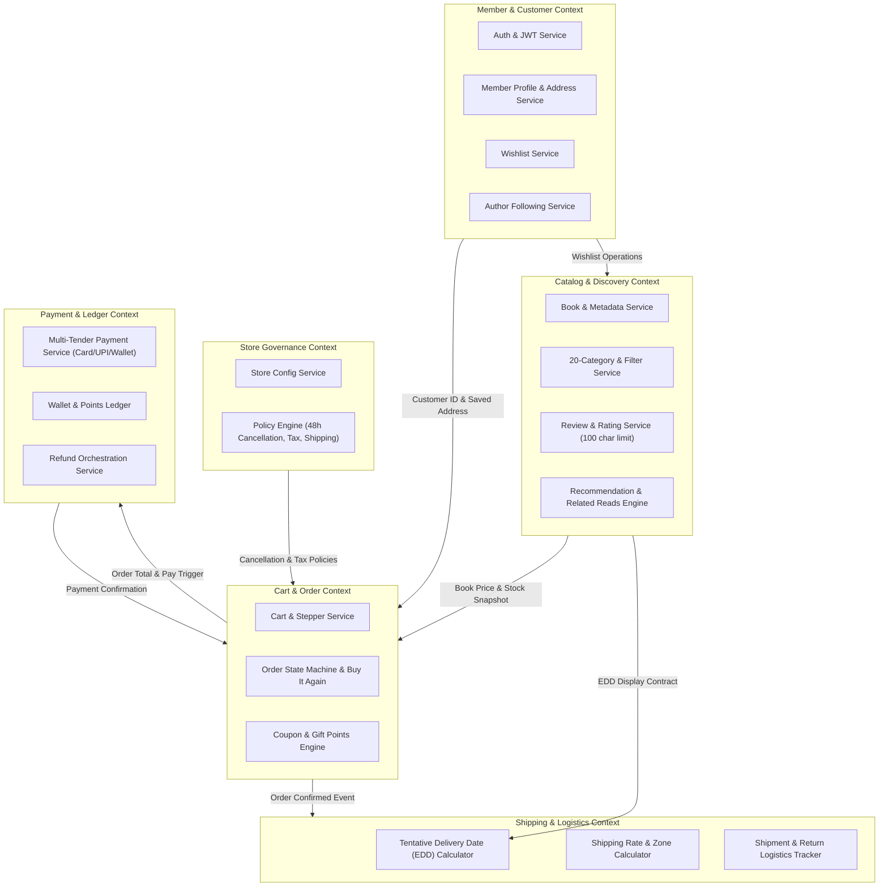

# Bookstore ("Book Worm") Backend Architecture & Requirements Specification

This document provides the consolidated, reverse-engineered backend requirements and architecture specification for the **Book Worm** E-Commerce platform. It incorporates all customer journeys, UI wireframes, architecture diagrams, domain workflows, and technology stack specifications.

---

## 1. Executive Summary & Technology Stack

### 1.1 Platform Context
- **Platform Name**: Book Worm
- **Domain**: E-Commerce Bookstore Platform (Books, E-Books, Authors, Merchandising)
- **Primary Objective**: An end-to-end online store enabling customers (Guest & Registered Members) to browse, discover, review, wishlist, cart, and purchase physical and digital books with multiple payment and delivery options.

### 1.2 Technology & Runtime Architecture
- **Backend Framework**: Java 17+ / Spring Boot 3.x
- **Build System**: Maven (`./mvn clean install`, `./mvn spring-boot:run`)
- **Database**: PostgreSQL (Community Edition / Managed PostgreSQL)
- **API Standard**: OpenAPI 3.0 / Swagger Specification
- **Security & Tokens**: JWT (RS256/HS256) with role/entitlement claims
- **Deployment Targets**: Local runtime with container readiness for Red Hat OpenShift (IBM ROKS / AWS ROSA)

---

## 2. Slide Inventory & Requirements Traceability

| Slide Ref / Title | Content Type | Extracted Requirements & Features | Status |
| :--- | :--- | :--- | :--- |
| **Slide 3: Use Case Customer Journeys** | Journey Flow | 12-step customer journey: Authentication, Order History with "Buy It Again", Product Catalog by Category, Brand browsing, Tentative Delivery Date (EDD), Related Products, Basket/Cart, Delivery Address Selection, Payment Options, Gift Points Redemption, Payment Confirmation, Order Cancellation within 48 hours. | Consolidated |
| **Architecture Diagram** | System Architecture | 6 core backend domains: Member, Store, Catalog, Order, Payment, Shipping; User roles (Guest, Registered); Event transitions between Home, Browse, Cart, Payment Processing, Shipment. | Consolidated |
| **Slide 5 / Home Wireframe (E-Bookstore Platform)** | UI Wireframe | Dark-themed UI; Global header with navigation (`My Orders`, `My Wishlist`, `My Writers`); Global search; 20-category sidebar; Top filter bar (Language, Format, Price Range, Sort by Relevance); Home sections: *Recommended for You*, *Bestsellers this Month*, *New Launches*. | Consolidated |
| **Slide 6 / Catalogue Page** | UI Wireframe | Category browsing, Brand browsing, Product card layout (Cover, Title, Author, Format, Price in ₹ INR, Tentative Delivery Date, Genre tags). | Consolidated |
| **Slide 7 / Product Details Page (PDP)** | UI Wireframe | Breadcrumb navigation; Book details (Cover, Title, Author link, Publisher, Format, Price, EDD); Metadata (Language, Rating, Copies Sold); Actions (`Add to Cart`, `Add to Wishlist`); "About the Writer" bio; Reviews & Ratings section (1-5 star submission, 100-char review text, existing reviews list); "Related Reads" sidebar. | Consolidated |
| **Slide 8 / Shopping Cart & Checkout** | UI Wireframe | Checkout breadcrumb; Cart item management with quantity steppers (`- 1 +`); Address selection (`Use Saved Address` toggle vs. full address form); Grand Total breakdown (Item Price, Tax, Delivery Charges, Coupon Apply input, Discount, Total Payable in ₹ INR); `Pay Now` trigger. | Consolidated |
| **Slide 9 / Payment Modal Screen** | UI Wireframe | Modal overlay; Total Payable Amount; Multi-tender selection: `Credit Card`, `Debit card`, `UPI`, `Wallet`; Card details capture (Card Number, Name on Card, CVV, Expiry MM/YYYY). | Consolidated |
| **Slide 10 / Purchase Confirmation** | UI Wireframe | Order success modal; Confirmation icon; Summary of purchased books with thumbnail, title, author, price, and tentative delivery date; `Continue your Shopping` action. | Consolidated |
| **Slide 11: Technology Components & Workflow** | Technical Blueprint | PostgreSQL database; Spring Boot services; OpenAPI Spec generation; ICA Agent test generator; Local and Cloud (AWS ROSA / IBM ROKS) readiness. | Consolidated |
| **Slide 12: Backend API Development Workflow** | Implementation Process | 9-step development lifecycle from wireframe analysis, OpenAPI generation, Spring Boot scaffolding, PostgreSQL configuration, local run/test to Git feature branch workflow. | Consolidated |

---

## 3. Functional Requirements

### 3.1 Identity, Member & Access Management (Member Domain)
- **FR-MEM-01 (Authentication & Guest Sessions)**: Provide registration and login via email/password. Support unauthenticated Guest sessions and seamlessly merge guest carts and state into Registered Member accounts upon authentication.
- **FR-MEM-02 (User Profile & Address Book)**: Manage user profiles, contact details (Email, Phone with country code `+91`), and multiple saved shipping addresses.
- **FR-MEM-03 (Role & Entitlement Governance)**: Enforce RBAC (Guest, Registered Member, Store Admin, Catalog Manager, Fulfillment Agent, CSR) and entitlements governing catalog access, pricing tiers, and administrative capabilities.
- **FR-MEM-04 (My Wishlist Management)**: Allow registered members to add books to their wishlist from the PDP, view wishlisted books, and move items between wishlist and shopping cart.
- **FR-MEM-05 (My Writers / Author Following)**: Allow members to view author profiles and track book publications from followed authors.

### 3.2 Store Governance & Administration (Store Domain)
- **FR-STR-01 (Multi-Store Setup)**: Create and configure store instances with currency (INR - ₹), locale, and default store configurations.
- **FR-STR-02 (Catalog Mapping)**: Map master or customized product catalogs to specific store instances.
- **FR-STR-03 (Store Policy Engine - Configurable & Provisional)**: Define and enforce store-level configurable rules. The following parameters are explicitly provisional and configurable per store instance (via database/application configuration):
  - *Tax Rate*: Default provisional value e.g., ~12% (Configurable; pending confirmation).
  - *Free Delivery Threshold*: Default provisional value e.g., ₹500 (Configurable; pending confirmation).
  - *Return Window*: Default provisional window e.g., 7 days post-delivery (Configurable; pending confirmation).
  - *Loyalty Points Conversion Rate*: Default provisional rate e.g., 1 point = ₹1 (Configurable; pending confirmation).
  - *Order Cancellation Window*: 48 hours as indicated on Slide 3 (Configurable per store policy).

### 3.3 Catalog, Merchandising & Discovery (Catalog Domain)
- **FR-CAT-01 (20-Category Taxonomy Navigation)**: Support structured taxonomy with 20 primary categories: `Romance`, `Mystery`, `Science Fiction`, `Fantasy`, `Historical`, `Biography`, `Self-help`, `Memoir`, `Travel`, `Cooking`, `Children's`, `Young Adult`, `Comics & Graphic Novels`, `Poetry`, `Drama`, `Science`, `Philosophy`, `Religion`, `Language Learning`, and `All`.
- **FR-CAT-02 (Multi-Faceted Search & Filtering)**: Provide full-text book search by title, author, and ISBN. Support combined filtering by:
  - *Language* (e.g., English, Hindi, etc.)
  - *Binding Format* (Paperback, Hardcover, eBook)
  - *Price Range* (Min - Max slider/tiers)
  - *Brand / Publisher* (e.g., ABC Publishers)
  - *Sort by* (Relevance, Price Low-to-High, Price High-to-Low, Customer Rating, Newest)
- **FR-CAT-03 (Curated Landing Sections)**: Dynamically populate home page collections:
  - *Recommended for You*: Personalized recommendations computed from user order history and browsing patterns.
  - *Bestsellers this Month*: Aggregated monthly top-selling titles.
  - *New Launches*: Newly published or recently cataloged book titles.
- **FR-CAT-04 (Book Details & Metadata)**: Provide detailed product page metadata: Title, Author, Publisher, Binding Format, Price (₹), Language, Sales metric (e.g., "145 copies sold"), Overall Star Rating (1–5), Description, and Tentative Delivery Date.
- **FR-CAT-05 (Author Bio / About the Writer)**: Serve dedicated author details including author name, photo, bio, and associated titles.
- **FR-CAT-06 (Reviews & Rating Subsystem)**:
  - Display aggregated star ratings and paginated customer reviews.
  - Allow authenticated users to submit reviews (1 to 5 star rating, review text up to 100 characters max).
- **FR-CAT-07 (Merchandising / Related Reads)**: Compute and serve cross-sell and up-sell book recommendations ("Related Reads") on the product details page.

### 3.4 Cart, Order & Promotions (Order Domain)
- **FR-ORD-01 (Shopping Cart Management)**: Support item additions, quantity modifications (`- 1 +`), item removal, and subtotal recalculation for both Guest and Member sessions.
- **FR-ORD-02 (Buy It Again / Re-order)**: Enable customers to browse past orders in `My Orders` and immediately re-add previously purchased books to the cart with a single click.
- **FR-ORD-03 (Checkout & Order Calculation)**: Dynamically calculate order financial breakdown:
  - Base Item Price summation
  - Applicable Taxes (e.g., GST)
  - Delivery / Shipping Charges (with Free Delivery rule evaluation)
  - Promotional Coupon Discount deduction
  - Total Payable Amount
- **FR-ORD-04 (Address Capture & Saved Addresses)**: Allow selection between previously saved addresses (`Use Saved Address`) or submission of new delivery address fields: First Name, Last Name, Address Line, City, State, Country, Postal Code (PIN), Email, Phone Number.
- **FR-ORD-05 (Coupons & Gift Points Redemption)**: Validate and apply coupon discount codes. Support redeeming available loyalty gift points against the payable total.
- **FR-ORD-06 (Order Lifecycle Orchestration)**: Transition orders across states: `CREATED` $\rightarrow$ `PENDING_PAYMENT` $\rightarrow$ `CONFIRMED` $\rightarrow$ `PROCESSING` $\rightarrow$ `SHIPPED` $\rightarrow$ `DELIVERED` $\rightarrow$ `CANCELLED` / `RETURNED`.
- **FR-ORD-07 (48-Hour Order Cancellation Rule)**: Allow customers to cancel placed orders **within 48 hours of purchase**, provided the order has not progressed to `SHIPPED` / `DELIVERED` status.
- **FR-ORD-08 (Order Confirmation & Receipt)**: Generate unique Order ID upon successful payment, display purchased item summary with tentative delivery dates, and issue order confirmation.

### 3.5 Payment Processing (Payment Domain)
- **FR-PAY-01 (Multi-Option Payment Initiation)**: Support payment processing across multiple payment methods:
  - `Credit Card` (Card Number, Name on Card, CVV, Expiry Date MM/YYYY)
  - `Debit Card`
  - `UPI`
  - `Wallet` / Gift Balance
- **FR-PAY-02 (Split & Partial Tender Payments)**: Support combining internal Wallet/Gift balances with external gateway settlement for the remaining balance.
- **FR-PAY-03 (Payment Verification & Webhooks)**: Securely verify payment gateway callback tokens, signatures, and transaction IDs before finalizing orders.
- **FR-PAY-04 (Automated Refund Execution)**: Automatically trigger refund workflows back to original payment methods or user wallet when orders are cancelled within the 48-hour window or returned.

### 3.6 Shipping & Logistics (Shipping Domain)
- **FR-SHP-01 (Tentative Delivery Date / EDD)**: Dynamically calculate and display the tentative delivery date (e.g., "Delivery by Mon, 21 Jul") across product listings, book details, cart, checkout, and order confirmation.
- **FR-SHP-02 (Shipping Rate & Zone Calculation)**: Compute delivery charges based on destination PIN code, order weight, and free delivery thresholds defined by store policies.
- **FR-SHP-03 (Shipment Tracking & Reverse Logistics)**: Assign carrier tracking IDs, track delivery milestones, and generate return shipping manifests for approved return requests.

---

## 4. Non-Functional Requirements

### 4.1 Performance & Latency
- **NFR-PERF-01**: Catalog browsing, category filtering, and book search P95 response time must be $\le 150\text{ ms}$.
- **NFR-PERF-02**: Cart updates and checkout total calculations must complete within $\le 300\text{ ms}$.
- **NFR-PERF-03**: Payment verification webhook processing must complete within $\le 500\text{ ms}$.

### 4.2 Scalability & Reliability
- **NFR-SCAL-01**: Stateless Spring Boot application layer supporting horizontal scaling.
- **NFR-SCAL-02**: PostgreSQL connection pooling (HikariCP) optimized for peak connection loads.
- **NFR-SCAL-03**: Target 99.95% system uptime with graceful degradation for recommendation engines.

### 4.3 Security & Compliance
- **NFR-SEC-01**: Transport encryption via TLS 1.3 for all REST API endpoints.
- **NFR-SEC-02**: Secure credential storage using BCrypt / Argon2id password hashing.
- **NFR-SEC-03**: PCI-DSS adherence: Backend must never store raw card numbers, CVVs, or expiration dates; card data is tokenized via client-side gateway integration.
- **NFR-SEC-04**: Input validation and output sanitization across all REST endpoints to prevent SQL Injection, XSS, and parameter tampering.
- **NFR-SEC-05**: Review submission character limit strictly enforced at backend level ($\le 100$ characters).

### 4.4 Data Integrity & Auditability
- **NFR-DAT-01**: ACID transaction guarantees for order placement, inventory deduction, wallet balance updates, and payment reconciliation.
- **NFR-DAT-02**: Strict idempotency on order submission and payment capture endpoints using `Idempotency-Key` headers.
- **NFR-DAT-03**: Immutable financial transaction and payment ledger records.

---

## 5. User Roles & Personas

| Role Code | Role Name | System Description & Access Matrix |
| :--- | :--- | :--- |
| **ROLE_GUEST** | Guest User | Anonymous shopper. Can browse catalogs, search, view book details, read reviews, add items to session cart, and proceed to checkout with mandatory address & contact details. |
| **ROLE_MEMBER** | Registered Member | Authenticated customer. Full browsing, persistent cart across devices, manage `My Orders` with "Buy It Again", manage `My Wishlist`, follow `My Writers`, submit reviews (100 char limit), redeem coupons/points, cancel orders within 48h. |
| **ROLE_STORE_ADMIN** | Store Administrator | Manages store instances, binds catalogs to stores, defines store policies (cancellation windows, tax rates, shipping rules). |
| **ROLE_CATALOG_ADMIN**| Catalog Manager | Creates and updates book listings, authors, categories, formats, prices, publisher details, and merchandising rules. |
| **ROLE_CSR** | Customer Support Agent | Accesses customer orders, inspects payment/refund statuses, assists with order cancellation/return exceptions. |
| **ROLE_FULFILLMENT** | Logistics Agent | Manages order packing, shipment dispatch, carrier tracking assignment, and return parcel inspection. |

---

## 6. User Stories & Acceptance Criteria

### 6.1 Discovery & Browsing
- **US-CAT-01 (20-Category & Multi-Faceted Filter Navigation)**
  - *As a* Book Worm shopper,
  - *I want to* filter books by category, language, format (paperback/ebook), price range, and sort by relevance,
  - *So that* I can pinpoint the exact book I am looking for.
  - *Acceptance Criteria*:
    1. Selecting any of the 20 categories filters the catalog accurately.
    2. Multiple filters (e.g. Self-help + Paperback + Price < ₹400) combine with logical AND conditions.
    3. Results return book cover, title, author, price (₹), format, and tentative delivery date.

- **US-CAT-02 (Home Page Collections)**
  - *As a* Book Worm shopper,
  - *I want to* see distinct shelves for *Recommended for You*, *Bestsellers this Month*, and *New Launches*,
  - *So that* I can discover trending and personalized titles immediately.
  - *Acceptance Criteria*:
    1. Unauthenticated users see popular recommendations; authenticated users see recommendations influenced by past orders.
    2. Bestsellers reflect top order volume over the last 30 days.

### 6.2 Product Details & Social Proof
- **US-CAT-03 (Book Details & Author Bio)**
  - *As a* shopper,
  - *I want to* view comprehensive book information, author bio ("About the Writer"), and related reads,
  - *So that* I have complete context before making a purchase decision.
  - *Acceptance Criteria*:
    1. Displays book cover, title, author link, publisher, format, price, language, rating, and copies sold count.
    2. Displays author photo, bio, and related book suggestions.

- **US-CAT-04 (Ratings & Review Submission)**
  - *As a* Registered Member,
  - *I want to* submit a star rating (1–5) and a written review up to 100 characters,
  - *So that* I can share my feedback on the book.
  - *Acceptance Criteria*:
    1. Backend validates that review text does not exceed 100 characters.
    2. Star rating must be an integer between 1 and 5.
    3. Newly submitted review updates the average rating calculation.

### 6.3 Wishlist & Author Following
- **US-MEM-01 (Wishlist Management)**
  - *As a* Registered Member,
  - *I want to* save books to `My Wishlist` from the PDP,
  - *So that* I can purchase them later.
  - *Acceptance Criteria*:
    1. `Add to Wishlist` endpoint toggles/stores book in member's wishlist.
    2. Member can view wishlisted items under `My Wishlist` and move them to cart.

### 6.4 Cart, Checkout & Orders
- **US-ORD-01 (Cart Management & Quantity Adjustment)**
  - *As a* shopper,
  - *I want to* increment/decrement item quantities (`- 1 +`) in my cart,
  - *So that* my cart totals and taxes update in real time.
  - *Acceptance Criteria*:
    1. Quantity updates immediately recalculate line total, taxes, and grand total.
    2. Decrementing below 1 removes item or prompts removal.

- **US-ORD-02 (Delivery Address & Saved Address Selection)**
  - *As a* customer checking out,
  - *I want to* choose a saved address or enter a new delivery address with phone (+91) and PIN code,
  - *So that* my order is routed to the correct destination.
  - *Acceptance Criteria*:
    1. `Use Saved Address` toggle loads default member address.
    2. New address form validates required fields (First Name, Last Name, Address, City, State, Country, PIN, Email, Phone).

- **US-ORD-03 (Coupons & Promotions)**
  - *As a* customer checking out,
  - *I want to* apply promo coupons and redeem gift points,
  - *So that* discounts are subtracted from my grand total before payment.
  - *Acceptance Criteria*:
    1. Valid coupon applies configured percentage or fixed discount.
    2. Invalid or expired coupon returns descriptive error.

- **US-ORD-04 (48-Hour Order Cancellation)**
  - *As a* Registered Member,
  - *I want to* cancel an order within 48 hours of placing it,
  - *So that* I receive a full refund if I change my mind.
  - *Acceptance Criteria*:
    1. System checks `order_timestamp`: if elapsed time $\le 48\text{ hours}$ and status $\ne \text{SHIPPED}$, cancellation is approved.
    2. If elapsed time $> 48\text{ hours}$ or order is already shipped, cancellation is rejected with policy message.
    3. Cancellation automatically triggers refund workflow.

- **US-ORD-05 (Buy It Again from Order History)**
  - *As a* Registered Member,
  - *I want to* click "Buy It Again" on any past order in `My Orders`,
  - *So that* all items from that order are added directly to my active cart.
  - *Acceptance Criteria*:
    1. Validates current stock availability for all items in the previous order.
    2. Adds available items to active cart and navigates user to checkout.

### 6.5 Payments
- **US-PAY-01 (Multi-Option Payment & Settlement)**
  - *As a* customer on the payment screen,
  - *I want to* select from Credit Card, Debit Card, UPI, or Wallet and complete payment,
  - *So that* my order is confirmed.
  - *Acceptance Criteria*:
    1. Validates payment payload for selected method.
    2. Upon payment confirmation, order transitions to `CONFIRMED` and returns purchase success summary.

---

## 7. Business Capabilities

```
┌─────────────────────────────────────────────────────────────────────────────────┐
│                          BOOK WORM E-COMMERCE PLATFORM                          │
└────────────────────────────────────────┬────────────────────────────────────────┘
                                         │
 ┌─────────────────┬─────────────────────┼─────────────────────┬──────────────────┐
 ▼                 ▼                     ▼                     ▼                  ▼
┌──────────────┐ ┌─────────────────┐ ┌───────────────────┐ ┌──────────────┐ ┌──────────────┐
│  1. Identity │ │ 2. Catalog &    │ │ 3. Cart & Order   │ │  4. Payment  │ │ 5. Logistics │
│   & Customer │ │    Discovery    │ │    Fulfillment    │ │ & Settlement │ │ & Delivery   │
└──────────────┘ └─────────────────┘ └───────────────────┘ └──────────────┘ └──────────────┘
  │ L2:            │ L2:               │ L2:                 │ L2:            │ L2:
  ├─Auth/Session   ├─20-Taxonomy       ├─Cart Stepper        ├─Multi-Tender   ├─EDD Calculator
  ├─Address Book   ├─Multi-Filter Search├─Address Selection  ├─Card/UPI/Wallet├─Zone/PIN Rates
  ├─Wishlist       ├─Recommendations   ├─Promotions/Coupons  ├─Split Ledger   ├─Dispatch Track
  ├─My Writers     ├─PDP & Metadata    ├─Order State Machine └─Refund Engine  └─Reverse Pickups
  └─Entitlements   ├─Reviews (100 char)├─48h Cancellation
                   └─Related Reads     └─Buy It Again
```

---

## 8. Domain Boundaries & Context Architecture



---

## 9. Backend Modules & Entities

```
book-worm-backend/
├── src/main/java/com/bookworm/
│   ├── member/          # Auth, Profile, Address, Wishlist, Author Following
│   ├── store/           # Store Config, Store Policies (48h cancel, tax)
│   ├── catalog/         # Books, Categories, Authors, Publishers, Reviews, Search
│   ├── recommendation/  # Personalized, Bestsellers, New Launches, Related Reads
│   ├── cart/            # Cart, CartItem, Quantity Steppers, Cart Merging
│   ├── order/           # Order, OrderItem, State Machine, Buy It Again
│   ├── promotion/       # Coupons, Discounts, Gift Points
│   ├── payment/         # Card/UPI/Wallet Transactions, Gateways, Refunds
│   └── shipping/        # EDD Calculation, Rates, Shipments, Reverse Logistics
```

### Core Entity Schema Mapping

1. **`User` / `Member`**: `user_id`, `email`, `password_hash`, `role`, `first_name`, `last_name`, `phone`, `created_at`.
2. **`Address`**: `address_id`, `user_id`, `first_name`, `last_name`, `address_line`, `city`, `state`, `country`, `pin_code`, `phone_number`, `is_default`.
3. **`Book`**: `book_id`, `title`, `author_id`, `publisher_id`, `isbn`, `category_id`, `format` (PAPERBACK/HARDCOVER/EBOOK), `price`, `language`, `cover_image_url`, `description`, `sales_count`, `average_rating`, `rating_count`, `stock_quantity`, `created_at`.
4. **`Author`**: `author_id`, `name`, `bio`, `avatar_url`.
5. **`Category`**: `category_id`, `name` (one of the 20 categories), `slug`, `display_order`.
6. **`Review`**: `review_id`, `book_id`, `user_id`, `user_name`, `rating` (1-5), `review_text` (VARCHAR 100), `created_at`.
7. **`Wishlist` / `WishlistItem`**: `wishlist_id`, `user_id`, `book_id`, `added_at`.
8. **`Cart` / `CartItem`**: `cart_id`, `user_id` (nullable for guest), `session_token`, `book_id`, `quantity`, `unit_price`, `updated_at`.
9. **`Order`**: `order_id`, `order_number`, `user_id`, `status` (CREATED, CONFIRMED, PROCESSING, SHIPPED, DELIVERED, CANCELLED, RETURNED), `subtotal`, `tax_amount`, `shipping_charge`, `discount_amount`, `total_amount`, `shipping_address_id`, `tentative_delivery_date`, `created_at`, `cancelled_at`.
10. **`OrderItem`**: `order_item_id`, `order_id`, `book_id`, `title`, `format`, `quantity`, `unit_price`, `total_price`.
11. **`Coupon`**: `coupon_id`, `code`, `discount_type` (PERCENTAGE/FIXED), `discount_value`, `min_order_amount`, `valid_until`, `is_active`.
12. **`PaymentTransaction`**: `transaction_id`, `order_id`, `payment_method` (CREDIT_CARD, DEBIT_CARD, UPI, WALLET), `amount`, `status` (PENDING, SUCCESS, FAILED, REFUNDED), `gateway_ref_id`, `created_at`.
13. **`Shipment`**: `shipment_id`, `order_id`, `carrier_name`, `tracking_number`, `status`, `estimated_delivery_date`, `dispatched_at`, `delivered_at`.

---

## 10. API Domains & Operation Signatures

| API Domain | Path Prefix | Key Operation Signatures |
| :--- | :--- | :--- |
| **Auth & Member** | `/api/v1/auth`, `/api/v1/members` | `POST /auth/register`, `POST /auth/login`, `POST /auth/logout`, `GET /members/profile`, `GET /members/addresses`, `POST /members/addresses`, `GET /members/wishlist`, `POST /members/wishlist/{bookId}`, `DELETE /members/wishlist/{bookId}`, `GET /members/writers` |
| **Catalog & Search** | `/api/v1/catalog`, `/api/v1/books` | `GET /catalog/categories`, `GET /books` (query params: `category`, `language`, `format`, `minPrice`, `maxPrice`, `search`, `sort`, `page`), `GET /books/{id}`, `GET /books/{id}/reviews`, `POST /books/{id}/reviews` (validated max 100 chars), `GET /authors/{id}` |
| **Recommendations** | `/api/v1/recommendations` | `GET /recommendations/for-you`, `GET /recommendations/bestsellers`, `GET /recommendations/new-launches`, `GET /recommendations/related/{bookId}` |
| **Cart** | `/api/v1/cart` | `GET /cart`, `POST /cart/items`, `PUT /cart/items/{itemId}` (quantity stepper), `DELETE /cart/items/{itemId}`, `POST /cart/merge` |
| **Order & Checkout** | `/api/v1/orders` | `POST /orders/calculate` (totals preview), `POST /orders/checkout`, `GET /orders`, `GET /orders/{id}`, `POST /orders/{id}/cancel` (48h policy check), `POST /orders/{id}/buy-again` |
| **Promotions** | `/api/v1/promotions` | `POST /promotions/apply-coupon`, `GET /promotions/gift-points` |
| **Payment** | `/api/v1/payments` | `POST /payments/initiate`, `POST /payments/confirm`, `POST /payments/webhook`, `GET /payments/wallet-balance` |
| **Shipping** | `/api/v1/shipping` | `GET /shipping/edd` (pincode lookup), `GET /shipping/rates`, `GET /shipping/track/{orderId}` |

---

## 11. Data Ownership Matrix

| Data Entity | Primary Module | Read Access | Write Access | Storage & Consistency Pattern |
| :--- | :--- | :--- | :--- | :--- |
| **User & Auth Credentials** | `member` | `member`, `order` | `member` | PostgreSQL (Encrypted, Unique constraints) |
| **Addresses** | `member` | `member`, `order`, `shipping` | `member` | PostgreSQL (Normalized relational) |
| **Wishlist & Author Follows** | `member` | `member`, `catalog` | `member` | PostgreSQL (Foreign key cascades) |
| **Categories (20 Taxonomy)** | `catalog` | All modules | `catalog` (Admin) | PostgreSQL (Cached in memory/Redis) |
| **Books, Authors, Publishers**| `catalog` | All modules | `catalog` (Admin) | PostgreSQL (Indexed by category, format, price) |
| **Reviews & Ratings** | `catalog` | All modules | `catalog` (Member) | PostgreSQL (Check constraint `length(review_text) <= 100`) |
| **Recommendations** | `recommendation` | `catalog`, UI | `recommendation` | Dynamic SQL queries / Aggregated Views |
| **Cart & Cart Items** | `cart` | `cart`, `order` | `cart` | PostgreSQL / Redis (TTL session backing) |
| **Orders & Order Items** | `order` | `order`, `member`, `payment`, `shipping` | `order` | PostgreSQL (Strict ACID Transactional) |
| **Coupons & Gift Points** | `promotion` | `order`, `cart` | `promotion` | PostgreSQL (Transactional ledger) |
| **Payment Transactions** | `payment` | `order`, `payment`, CSR | `payment` | PostgreSQL (Immutable ledger) |
| **Shipments & EDD** | `shipping` | `order`, `shipping`, Member | `shipping` | PostgreSQL (Status timeline logging) |

---

## 12. Business Rules & Ambiguity Resolutions

| Ambiguity / Potential Conflict | Slide Source & Context | Resolution / Formal Business Rule |
| :--- | :--- | :--- |
| **48-Hour Order Cancellation Rule** | Slide 3 (Step 12: "Cancel Order Within 48 hrs") vs Architecture ("Cancel Order") | **Enforced Rule**: An order can be cancelled by the customer if and only if: `current_timestamp - order_created_at <= cancellation_window_hours` (default 48 hours, configurable) AND `order_status IN ('CREATED', 'PENDING_PAYMENT', 'CONFIRMED', 'PROCESSING')`. Once the order status transitions to `SHIPPED` or `DELIVERED`, cancellation is disabled and the customer must follow the standard return process. |
| **Provisional Financial & Policy Parameters** | Slide 6/8 wireframe placeholders (Tax: ₹62, Delivery: Free, Discount: ₹100) | **Configurable / Provisional**: Tax percentage, free-delivery threshold, return window, and loyalty points redemption rate are explicitly treated as configurable store policy parameters rather than hardcoded constants. |
| **Slide 5 Label ("Shopping Cart") vs Visual UI** | Slide 5 title reads "The following provides the Shopping Cart for update", but the screenshot displays the Product Details Page (PDP). | **Reconciliation**: The specification explicitly details both the **Product Details Page (PDP)** (Slide 5 visual) with Add-to-Cart / Add-to-Wishlist, and the **Checkout / Shopping Cart View** (Slide 6 visual) with line items, quantity steppers (`- 1 +`), and Grand Total calculation. |
| **Review Text Length** | Wireframe on Slide 5 displays `0/100` character counter for review input. | **Enforced Rule**: Backend entity validation enforces `@Size(max = 100)` / database constraint `VARCHAR(100)` on the `review_text` field. |
| **Currency & Localization** | Wireframes consistently display Indian Rupee (`₹`) pricing and `+91` phone prefix with Indian PIN codes. | **Enforced Rule**: Currency defaults to INR (`₹`). Phone numbers support `+91` format with 10 digits; PIN code validates 6-digit Indian postal codes with flexible international formatting fallback. |
| **"Buy It Again" / "Buy In Again" Reorder** | Slide 3 & Slide 4 note "User Browses Order History with Buy In Again feature". | **Enforced Rule**: Provides a dedicated endpoint `POST /api/v1/orders/{orderId}/buy-again` that checks live catalog inventory for all items in the historical order and batches them into the active cart. |

---

## 13. Assumptions & Out of Scope Items

### 13.1 Technical & Operational Assumptions
1. **Spring Boot / PostgreSQL Reference Stack**: As specified in Slides 11 & 12, the backend will be implemented in Java Spring Boot using Spring Data JPA, Hibernate, and PostgreSQL.
2. **Client-Side Card Tokenization**: Raw payment card numbers and CVVs are tokenized via simulated/actual payment gateway client elements, avoiding direct PCI card vaulting in the backend DB.
3. **Deterministic Delivery Estimation (EDD)**: Approximate delivery dates are computed based on destination PIN code proximity and dispatch SLA (e.g., standard 3–5 business days).

### 13.2 Out of Scope Items
1. Direct PCI-DSS Level 1 raw card data vaulting.
2. Physical warehouse robotics or automated conveyor hardware integration.
3. Third-party multi-vendor marketplace split payouts (platform operates as a direct retailer multi-store model).
4. Physical in-store Point-of-Sale (POS) barcode printer/scanner hardware drivers.
