# Book Worm Platform — Relational Database Design Specification (PostgreSQL / 3NF)

## 1. Architectural & Design Standards

- **Target Database Engine**: PostgreSQL 15+
- **Normalization Level**: Third Normal Form (3NF)
- **Primary Key Standard**: `UUID` (`UUIDv4` generated via `gen_random_uuid()`)
- **Audit Columns (Standard across mutable tables)**:
  - `created_at`: `TIMESTAMP WITH TIME ZONE NOT NULL DEFAULT CURRENT_TIMESTAMP`
  - `created_by`: `VARCHAR(100) NOT NULL DEFAULT 'SYSTEM'`
  - `updated_at`: `TIMESTAMP WITH TIME ZONE NOT NULL DEFAULT CURRENT_TIMESTAMP`
  - `updated_by`: `VARCHAR(100) NOT NULL DEFAULT 'SYSTEM'`
- **Soft Delete Standard (Standard across persistent domain entities)**:
  - `is_deleted`: `BOOLEAN NOT NULL DEFAULT FALSE`
  - `deleted_at`: `TIMESTAMP WITH TIME ZONE NULL`
- **Optimistic Locking Standard (Standard across concurrently updated entities)**:
  - `version`: `BIGINT NOT NULL DEFAULT 0`
- **Monetary Precision**: `NUMERIC(12, 2)` for currency amounts; `NUMERIC(5, 2)` for percentages/ratings.

---

## 2. Entity-Relationship Diagram (ERD)

```mermaid
erDiagram
    USERS ||--o{ ADDRESSES : "maintains"
    USERS ||--o| WISHLISTS : "owns"
    USERS ||--o{ REVIEWS : "authors"
    USERS ||--o{ CARTS : "has"
    USERS ||--o{ ORDERS : "places"
    USERS ||--o| LOYALTY_ACCOUNTS : "holds"
    USERS ||--o| WALLET_ACCOUNTS : "owns"

    STORES ||--o{ STORE_POLICIES : "configures"
    STORES ||--o{ ORDERS : "fulfills"

    CATEGORIES ||--o{ BOOKS : "classifies"
    AUTHORS ||--o{ BOOKS : "writes"
    PUBLISHERS ||--o{ BOOKS : "publishes"

    BOOKS ||--o{ REVIEWS : "receives"
    BOOKS ||--o{ WISHLIST_ITEMS : "saved_in"
    BOOKS ||--o{ CART_ITEMS : "added_to"
    BOOKS ||--o{ ORDER_ITEMS : "ordered_as"

    WISHLISTS ||--o{ WISHLIST_ITEMS : "contains"
    CARTS ||--o{ CART_ITEMS : "contains"

    ORDERS ||--o{ ORDER_ITEMS : "contains"
    ORDERS ||--o{ ORDER_STATUS_HISTORIES : "tracks"
    ORDERS ||--o{ PAYMENT_TRANSACTIONS : "settled_via"
    ORDERS ||--o| SHIPMENTS : "dispatched_as"
    ORDERS ||--o{ COUPON_REDEMPTIONS : "applies"

    COUPONS ||--o{ COUPON_REDEMPTIONS : "redeemed_in"
    LOYALTY_ACCOUNTS ||--o{ LOYALTY_TRANSACTIONS : "logs"
    WALLET_ACCOUNTS ||--o{ WALLET_TRANSACTIONS : "logs"
    PAYMENT_TRANSACTIONS ||--o{ REFUND_TRANSACTIONS : "refunds"
    SHIPMENTS ||--o{ TRACKING_EVENTS : "records"

    USERS {
        UUID user_id PK
        VARCHAR email UK
        VARCHAR password_hash
        VARCHAR first_name
        VARCHAR last_name
        VARCHAR phone
        VARCHAR role
        BOOLEAN is_deleted
        BIGINT version
    }

    ADDRESSES {
        UUID address_id PK
        UUID user_id FK
        VARCHAR first_name
        VARCHAR last_name
        VARCHAR address_line1
        VARCHAR address_line2
        VARCHAR city
        VARCHAR state
        VARCHAR country
        VARCHAR pin_code
        VARCHAR phone_number
        BOOLEAN is_default
        BOOLEAN is_deleted
        BIGINT version
    }

    STORES {
        UUID store_id PK
        VARCHAR store_code UK
        VARCHAR name
        VARCHAR currency_code
        VARCHAR locale
        BOOLEAN is_active
        BOOLEAN is_deleted
        BIGINT version
    }

    STORE_POLICIES {
        UUID policy_id PK
        UUID store_id FK
        INTEGER cancellation_window_hours
        NUMERIC tax_rate_percent
        NUMERIC free_delivery_threshold
        NUMERIC standard_delivery_fee
        NUMERIC loyalty_redemption_rate
        INTEGER return_window_days
        BOOLEAN is_deleted
        BIGINT version
    }

    CATEGORIES {
        UUID category_id PK
        VARCHAR name UK
        VARCHAR slug UK
        INTEGER display_order
        BOOLEAN is_active
        BOOLEAN is_deleted
        BIGINT version
    }

    AUTHORS {
        UUID author_id PK
        VARCHAR name
        TEXT bio
        VARCHAR avatar_url
        BOOLEAN is_deleted
        BIGINT version
    }

    PUBLISHERS {
        UUID publisher_id PK
        VARCHAR name UK
        BOOLEAN is_deleted
        BIGINT version
    }

    BOOKS {
        UUID book_id PK
        VARCHAR title
        VARCHAR isbn UK
        UUID author_id FK
        UUID publisher_id FK
        UUID category_id FK
        VARCHAR format
        NUMERIC price
        VARCHAR language
        VARCHAR cover_image_url
        TEXT description
        BIGINT sales_count
        NUMERIC average_rating
        INTEGER rating_count
        INTEGER stock_quantity
        BOOLEAN is_deleted
        BIGINT version
    }

    REVIEWS {
        UUID review_id PK
        UUID book_id FK
        UUID user_id FK
        VARCHAR reviewer_name
        INTEGER rating
        VARCHAR review_text
        BOOLEAN is_deleted
        BIGINT version
    }

    CARTS {
        UUID cart_id PK
        UUID user_id FK
        VARCHAR session_token
        BOOLEAN is_active
        BOOLEAN is_deleted
        BIGINT version
    }

    CART_ITEMS {
        UUID cart_item_id PK
        UUID cart_id FK
        UUID book_id FK
        INTEGER quantity
        NUMERIC unit_price
        BOOLEAN is_deleted
        BIGINT version
    }

    ORDERS {
        UUID order_id PK
        VARCHAR order_number UK
        UUID user_id FK
        UUID store_id FK
        UUID shipping_address_id FK
        VARCHAR status
        NUMERIC subtotal
        NUMERIC tax_amount
        NUMERIC delivery_charge
        NUMERIC discount_amount
        NUMERIC total_amount
        DATE tentative_delivery_date
        TIMESTAMP cancelled_at
        BOOLEAN is_deleted
        BIGINT version
    }

    ORDER_ITEMS {
        UUID order_item_id PK
        UUID order_id FK
        UUID book_id FK
        VARCHAR book_title
        VARCHAR book_format
        INTEGER quantity
        NUMERIC unit_price
        NUMERIC total_price
        BOOLEAN is_deleted
        BIGINT version
    }

    ORDER_STATUS_HISTORIES {
        UUID history_id PK
        UUID order_id FK
        VARCHAR from_status
        VARCHAR to_status
        TEXT reason
        VARCHAR changed_by
        TIMESTAMP created_at
    }

    COUPONS {
        UUID coupon_id PK
        VARCHAR code UK
        VARCHAR discount_type
        NUMERIC discount_value
        NUMERIC min_order_amount
        NUMERIC max_discount_amount
        TIMESTAMP valid_from
        TIMESTAMP valid_until
        BOOLEAN is_active
        BOOLEAN is_deleted
        BIGINT version
    }

    COUPON_REDEMPTIONS {
        UUID redemption_id PK
        UUID coupon_id FK
        UUID user_id FK
        UUID order_id FK
        NUMERIC discount_applied
        TIMESTAMP redeemed_at
    }

    LOYALTY_ACCOUNTS {
        UUID loyalty_account_id PK
        UUID user_id FK
        INTEGER points_balance
        BOOLEAN is_deleted
        BIGINT version
    }

    LOYALTY_TRANSACTIONS {
        UUID transaction_id PK
        UUID loyalty_account_id FK
        UUID order_id FK
        VARCHAR transaction_type
        INTEGER points
        INTEGER balance_after
        VARCHAR reason
        TIMESTAMP created_at
    }

    WALLET_ACCOUNTS {
        UUID wallet_id PK
        UUID user_id FK
        NUMERIC balance
        VARCHAR currency_code
        BOOLEAN is_deleted
        BIGINT version
    }

    WALLET_TRANSACTIONS {
        UUID transaction_id PK
        UUID wallet_id FK
        UUID order_id FK
        VARCHAR transaction_type
        NUMERIC amount
        NUMERIC balance_after
        TIMESTAMP created_at
    }

    PAYMENT_TRANSACTIONS {
        UUID transaction_id PK
        UUID order_id FK
        VARCHAR payment_method
        NUMERIC amount
        VARCHAR currency_code
        VARCHAR status
        VARCHAR gateway_ref_id
        VARCHAR masked_card_number
        BOOLEAN is_deleted
        BIGINT version
    }

    REFUND_TRANSACTIONS {
        UUID refund_id PK
        UUID payment_transaction_id FK
        UUID order_id FK
        NUMERIC refund_amount
        VARCHAR status
        VARCHAR reason
        BOOLEAN is_deleted
        BIGINT version
    }

    SHIPMENTS {
        UUID shipment_id PK
        UUID order_id FK
        VARCHAR carrier_name
        VARCHAR tracking_number
        VARCHAR status
        DATE estimated_delivery_date
        TIMESTAMP dispatched_at
        TIMESTAMP delivered_at
        BOOLEAN is_deleted
        BIGINT version
    }

    TRACKING_EVENTS {
        UUID event_id PK
        UUID shipment_id FK
        VARCHAR event_status
        VARCHAR location
        TIMESTAMP event_timestamp
        TEXT description
        TIMESTAMP created_at
    }
```

---

## 3. Database Schema Definitions (Tables, Columns & Constraints)

### 3.1 Member & Identity Domain

#### Table: `users`
Represents registered customers and administrative users.
- **Columns**:
  - `user_id`: `UUID NOT NULL DEFAULT gen_random_uuid()`
  - `email`: `VARCHAR(255) NOT NULL`
  - `password_hash`: `VARCHAR(255) NOT NULL`
  - `first_name`: `VARCHAR(100) NOT NULL`
  - `last_name`: `VARCHAR(100) NOT NULL`
  - `phone`: `VARCHAR(20) NULL`
  - `role`: `VARCHAR(30) NOT NULL DEFAULT 'ROLE_MEMBER'` (e.g. `ROLE_GUEST`, `ROLE_MEMBER`, `ROLE_STORE_ADMIN`, `ROLE_CATALOG_ADMIN`, `ROLE_CSR`, `ROLE_FULFILLMENT`)
  - `created_at`: `TIMESTAMP WITH TIME ZONE NOT NULL DEFAULT CURRENT_TIMESTAMP`
  - `created_by`: `VARCHAR(100) NOT NULL DEFAULT 'SYSTEM'`
  - `updated_at`: `TIMESTAMP WITH TIME ZONE NOT NULL DEFAULT CURRENT_TIMESTAMP`
  - `updated_by`: `VARCHAR(100) NOT NULL DEFAULT 'SYSTEM'`
  - `is_deleted`: `BOOLEAN NOT NULL DEFAULT FALSE`
  - `deleted_at`: `TIMESTAMP WITH TIME ZONE NULL`
  - `version`: `BIGINT NOT NULL DEFAULT 0`
- **Primary Key**: `pk_users` (`user_id`)
- **Unique Constraints**:
  - `uq_users_email`: `UNIQUE (email)` (enforced where `is_deleted = FALSE`)
- **Foreign Keys**: None
- **Indexes**:
  - `idx_users_email_active`: `ON users (email) WHERE is_deleted = FALSE`
  - `idx_users_role`: `ON users (role) WHERE is_deleted = FALSE`

#### Table: `addresses`
Customer delivery addresses.
- **Columns**:
  - `address_id`: `UUID NOT NULL DEFAULT gen_random_uuid()`
  - `user_id`: `UUID NOT NULL`
  - `first_name`: `VARCHAR(100) NOT NULL`
  - `last_name`: `VARCHAR(100) NOT NULL`
  - `address_line1`: `VARCHAR(255) NOT NULL`
  - `address_line2`: `VARCHAR(255) NULL`
  - `city`: `VARCHAR(100) NOT NULL`
  - `state`: `VARCHAR(100) NOT NULL`
  - `country`: `VARCHAR(100) NOT NULL DEFAULT 'India'`
  - `pin_code`: `VARCHAR(10) NOT NULL`
  - `phone_number`: `VARCHAR(20) NOT NULL`
  - `is_default`: `BOOLEAN NOT NULL DEFAULT FALSE`
  - `created_at`: `TIMESTAMP WITH TIME ZONE NOT NULL DEFAULT CURRENT_TIMESTAMP`
  - `created_by`: `VARCHAR(100) NOT NULL DEFAULT 'SYSTEM'`
  - `updated_at`: `TIMESTAMP WITH TIME ZONE NOT NULL DEFAULT CURRENT_TIMESTAMP`
  - `updated_by`: `VARCHAR(100) NOT NULL DEFAULT 'SYSTEM'`
  - `is_deleted`: `BOOLEAN NOT NULL DEFAULT FALSE`
  - `deleted_at`: `TIMESTAMP WITH TIME ZONE NULL`
  - `version`: `BIGINT NOT NULL DEFAULT 0`
- **Primary Key**: `pk_addresses` (`address_id`)
- **Foreign Keys**:
  - `fk_addresses_user`: `user_id REFERENCES users(user_id) ON DELETE RESTRICT`
- **Indexes**:
  - `idx_addresses_user_id`: `ON addresses (user_id) WHERE is_deleted = FALSE`

#### Table: `wishlists`
Customer wishlists.
- **Columns**:
  - `wishlist_id`: `UUID NOT NULL DEFAULT gen_random_uuid()`
  - `user_id`: `UUID NOT NULL`
  - `created_at`: `TIMESTAMP WITH TIME ZONE NOT NULL DEFAULT CURRENT_TIMESTAMP`
  - `created_by`: `VARCHAR(100) NOT NULL DEFAULT 'SYSTEM'`
  - `updated_at`: `TIMESTAMP WITH TIME ZONE NOT NULL DEFAULT CURRENT_TIMESTAMP`
  - `updated_by`: `VARCHAR(100) NOT NULL DEFAULT 'SYSTEM'`
  - `is_deleted`: `BOOLEAN NOT NULL DEFAULT FALSE`
  - `deleted_at`: `TIMESTAMP WITH TIME ZONE NULL`
  - `version`: `BIGINT NOT NULL DEFAULT 0`
- **Primary Key**: `pk_wishlists` (`wishlist_id`)
- **Unique Constraints**:
  - `uq_wishlists_user`: `UNIQUE (user_id)` (where `is_deleted = FALSE`)
- **Foreign Keys**:
  - `fk_wishlists_user`: `user_id REFERENCES users(user_id) ON DELETE RESTRICT`

#### Table: `wishlist_items`
Individual items saved in a wishlist.
- **Columns**:
  - `wishlist_item_id`: `UUID NOT NULL DEFAULT gen_random_uuid()`
  - `wishlist_id`: `UUID NOT NULL`
  - `book_id`: `UUID NOT NULL`
  - `added_at`: `TIMESTAMP WITH TIME ZONE NOT NULL DEFAULT CURRENT_TIMESTAMP`
  - `created_at`: `TIMESTAMP WITH TIME ZONE NOT NULL DEFAULT CURRENT_TIMESTAMP`
  - `created_by`: `VARCHAR(100) NOT NULL DEFAULT 'SYSTEM'`
  - `updated_at`: `TIMESTAMP WITH TIME ZONE NOT NULL DEFAULT CURRENT_TIMESTAMP`
  - `updated_by`: `VARCHAR(100) NOT NULL DEFAULT 'SYSTEM'`
  - `is_deleted`: `BOOLEAN NOT NULL DEFAULT FALSE`
  - `deleted_at`: `TIMESTAMP WITH TIME ZONE NULL`
  - `version`: `BIGINT NOT NULL DEFAULT 0`
- **Primary Key**: `pk_wishlist_items` (`wishlist_item_id`)
- **Unique Constraints**:
  - `uq_wishlist_items_unique_book`: `UNIQUE (wishlist_id, book_id)` (where `is_deleted = FALSE`)
- **Foreign Keys**:
  - `fk_wishlist_items_wishlist`: `wishlist_id REFERENCES wishlists(wishlist_id) ON DELETE CASCADE`
  - `fk_wishlist_items_book`: `book_id REFERENCES books(book_id) ON DELETE RESTRICT`
- **Indexes**:
  - `idx_wishlist_items_wishlist`: `ON wishlist_items (wishlist_id) WHERE is_deleted = FALSE`

---

### 3.2 Store Governance Domain

#### Table: `stores`
Store instances.
- **Columns**:
  - `store_id`: `UUID NOT NULL DEFAULT gen_random_uuid()`
  - `store_code`: `VARCHAR(50) NOT NULL`
  - `name`: `VARCHAR(100) NOT NULL`
  - `currency_code`: `VARCHAR(3) NOT NULL DEFAULT 'INR'`
  - `locale`: `VARCHAR(10) NOT NULL DEFAULT 'en_IN'`
  - `is_active`: `BOOLEAN NOT NULL DEFAULT TRUE`
  - `created_at`: `TIMESTAMP WITH TIME ZONE NOT NULL DEFAULT CURRENT_TIMESTAMP`
  - `created_by`: `VARCHAR(100) NOT NULL DEFAULT 'SYSTEM'`
  - `updated_at`: `TIMESTAMP WITH TIME ZONE NOT NULL DEFAULT CURRENT_TIMESTAMP`
  - `updated_by`: `VARCHAR(100) NOT NULL DEFAULT 'SYSTEM'`
  - `is_deleted`: `BOOLEAN NOT NULL DEFAULT FALSE`
  - `deleted_at`: `TIMESTAMP WITH TIME ZONE NULL`
  - `version`: `BIGINT NOT NULL DEFAULT 0`
- **Primary Key**: `pk_stores` (`store_id`)
- **Unique Constraints**:
  - `uq_stores_code`: `UNIQUE (store_code)` (where `is_deleted = FALSE`)

#### Table: `store_policies`
Store policy rules with provisional, configurable settings.
- **Columns**:
  - `policy_id`: `UUID NOT NULL DEFAULT gen_random_uuid()`
  - `store_id`: `UUID NOT NULL`
  - `cancellation_window_hours`: `INTEGER NOT NULL DEFAULT 48`
  - `tax_rate_percent`: `NUMERIC(5, 2) NOT NULL DEFAULT 12.00`
  - `free_delivery_threshold`: `NUMERIC(12, 2) NOT NULL DEFAULT 500.00`
  - `standard_delivery_fee`: `NUMERIC(12, 2) NOT NULL DEFAULT 50.00`
  - `loyalty_redemption_rate`: `NUMERIC(5, 2) NOT NULL DEFAULT 1.00`
  - `return_window_days`: `INTEGER NOT NULL DEFAULT 7`
  - `created_at`: `TIMESTAMP WITH TIME ZONE NOT NULL DEFAULT CURRENT_TIMESTAMP`
  - `created_by`: `VARCHAR(100) NOT NULL DEFAULT 'SYSTEM'`
  - `updated_at`: `TIMESTAMP WITH TIME ZONE NOT NULL DEFAULT CURRENT_TIMESTAMP`
  - `updated_by`: `VARCHAR(100) NOT NULL DEFAULT 'SYSTEM'`
  - `is_deleted`: `BOOLEAN NOT NULL DEFAULT FALSE`
  - `deleted_at`: `TIMESTAMP WITH TIME ZONE NULL`
  - `version`: `BIGINT NOT NULL DEFAULT 0`
- **Primary Key**: `pk_store_policies` (`policy_id`)
- **Unique Constraints**:
  - `uq_store_policies_store`: `UNIQUE (store_id)` (where `is_deleted = FALSE`)
- **Foreign Keys**:
  - `fk_store_policies_store`: `store_id REFERENCES stores(store_id) ON DELETE CASCADE`

---

### 3.3 Catalog & Discovery Domain

#### Table: `categories`
20-category taxonomy master.
- **Columns**:
  - `category_id`: `UUID NOT NULL DEFAULT gen_random_uuid()`
  - `name`: `VARCHAR(100) NOT NULL` (e.g. `Romance`, `Mystery`, `Science Fiction`, `Fantasy`, `Historical`, `Biography`, `Self-help`, `Memoir`, `Travel`, `Cooking`, `Children's`, `Young Adult`, `Comics & Graphic Novels`, `Poetry`, `Drama`, `Science`, `Philosophy`, `Religion`, `Language Learning`, `All`)
  - `slug`: `VARCHAR(100) NOT NULL`
  - `display_order`: `INTEGER NOT NULL DEFAULT 0`
  - `is_active`: `BOOLEAN NOT NULL DEFAULT TRUE`
  - `created_at`: `TIMESTAMP WITH TIME ZONE NOT NULL DEFAULT CURRENT_TIMESTAMP`
  - `created_by`: `VARCHAR(100) NOT NULL DEFAULT 'SYSTEM'`
  - `updated_at`: `TIMESTAMP WITH TIME ZONE NOT NULL DEFAULT CURRENT_TIMESTAMP`
  - `updated_by`: `VARCHAR(100) NOT NULL DEFAULT 'SYSTEM'`
  - `is_deleted`: `BOOLEAN NOT NULL DEFAULT FALSE`
  - `deleted_at`: `TIMESTAMP WITH TIME ZONE NULL`
  - `version`: `BIGINT NOT NULL DEFAULT 0`
- **Primary Key**: `pk_categories` (`category_id`)
- **Unique Constraints**:
  - `uq_categories_name`: `UNIQUE (name)` (where `is_deleted = FALSE`)
  - `uq_categories_slug`: `UNIQUE (slug)` (where `is_deleted = FALSE`)
- **Indexes**:
  - `idx_categories_display`: `ON categories (display_order, is_active) WHERE is_deleted = FALSE`

#### Table: `authors`
Author profiles for "About the writer".
- **Columns**:
  - `author_id`: `UUID NOT NULL DEFAULT gen_random_uuid()`
  - `name`: `VARCHAR(150) NOT NULL`
  - `bio`: `TEXT NULL`
  - `avatar_url`: `VARCHAR(500) NULL`
  - `created_at`: `TIMESTAMP WITH TIME ZONE NOT NULL DEFAULT CURRENT_TIMESTAMP`
  - `created_by`: `VARCHAR(100) NOT NULL DEFAULT 'SYSTEM'`
  - `updated_at`: `TIMESTAMP WITH TIME ZONE NOT NULL DEFAULT CURRENT_TIMESTAMP`
  - `updated_by`: `VARCHAR(100) NOT NULL DEFAULT 'SYSTEM'`
  - `is_deleted`: `BOOLEAN NOT NULL DEFAULT FALSE`
  - `deleted_at`: `TIMESTAMP WITH TIME ZONE NULL`
  - `version`: `BIGINT NOT NULL DEFAULT 0`
- **Primary Key**: `pk_authors` (`author_id`)
- **Indexes**:
  - `idx_authors_name`: `ON authors (name) WHERE is_deleted = FALSE`

#### Table: `publishers`
Publishers master ("Published by: ABC Publishers").
- **Columns**:
  - `publisher_id`: `UUID NOT NULL DEFAULT gen_random_uuid()`
  - `name`: `VARCHAR(150) NOT NULL`
  - `created_at`: `TIMESTAMP WITH TIME ZONE NOT NULL DEFAULT CURRENT_TIMESTAMP`
  - `created_by`: `VARCHAR(100) NOT NULL DEFAULT 'SYSTEM'`
  - `updated_at`: `TIMESTAMP WITH TIME ZONE NOT NULL DEFAULT CURRENT_TIMESTAMP`
  - `updated_by`: `VARCHAR(100) NOT NULL DEFAULT 'SYSTEM'`
  - `is_deleted`: `BOOLEAN NOT NULL DEFAULT FALSE`
  - `deleted_at`: `TIMESTAMP WITH TIME ZONE NULL`
  - `version`: `BIGINT NOT NULL DEFAULT 0`
- **Primary Key**: `pk_publishers` (`publisher_id`)
- **Unique Constraints**:
  - `uq_publishers_name`: `UNIQUE (name)` (where `is_deleted = FALSE`)

#### Table: `books`
Book catalog listings.
- **Columns**:
  - `book_id`: `UUID NOT NULL DEFAULT gen_random_uuid()`
  - `title`: `VARCHAR(255) NOT NULL`
  - `isbn`: `VARCHAR(20) NOT NULL`
  - `author_id`: `UUID NOT NULL`
  - `publisher_id`: `UUID NOT NULL`
  - `category_id`: `UUID NOT NULL`
  - `format`: `VARCHAR(30) NOT NULL` (`PAPERBACK`, `HARDCOVER`, `EBOOK`)
  - `price`: `NUMERIC(12, 2) NOT NULL`
  - `language`: `VARCHAR(50) NOT NULL DEFAULT 'English'`
  - `cover_image_url`: `VARCHAR(500) NULL`
  - `description`: `TEXT NULL`
  - `sales_count`: `BIGINT NOT NULL DEFAULT 0`
  - `average_rating`: `NUMERIC(3, 2) NOT NULL DEFAULT 0.00`
  - `rating_count`: `INTEGER NOT NULL DEFAULT 0`
  - `stock_quantity`: `INTEGER NOT NULL DEFAULT 0`
  - `created_at`: `TIMESTAMP WITH TIME ZONE NOT NULL DEFAULT CURRENT_TIMESTAMP`
  - `created_by`: `VARCHAR(100) NOT NULL DEFAULT 'SYSTEM'`
  - `updated_at`: `TIMESTAMP WITH TIME ZONE NOT NULL DEFAULT CURRENT_TIMESTAMP`
  - `updated_by`: `VARCHAR(100) NOT NULL DEFAULT 'SYSTEM'`
  - `is_deleted`: `BOOLEAN NOT NULL DEFAULT FALSE`
  - `deleted_at`: `TIMESTAMP WITH TIME ZONE NULL`
  - `version`: `BIGINT NOT NULL DEFAULT 0`
- **Primary Key**: `pk_books` (`book_id`)
- **Unique Constraints**:
  - `uq_books_isbn`: `UNIQUE (isbn)` (where `is_deleted = FALSE`)
- **Foreign Keys**:
  - `fk_books_author`: `author_id REFERENCES authors(author_id) ON DELETE RESTRICT`
  - `fk_books_publisher`: `publisher_id REFERENCES publishers(publisher_id) ON DELETE RESTRICT`
  - `fk_books_category`: `category_id REFERENCES categories(category_id) ON DELETE RESTRICT`
- **Indexes**:
  - `idx_books_category_id`: `ON books (category_id) WHERE is_deleted = FALSE`
  - `idx_books_author_id`: `ON books (author_id) WHERE is_deleted = FALSE`
  - `idx_books_price`: `ON books (price) WHERE is_deleted = FALSE`
  - `idx_books_language`: `ON books (language) WHERE is_deleted = FALSE`
  - `idx_books_format`: `ON books (format) WHERE is_deleted = FALSE`
  - `idx_books_sales_count`: `ON books (sales_count DESC) WHERE is_deleted = FALSE`
  - `idx_books_created_at`: `ON books (created_at DESC) WHERE is_deleted = FALSE`
  - `idx_books_title_trgm`: `ON books (title) WHERE is_deleted = FALSE` (for full/partial text search)

#### Table: `reviews`
Book reviews and ratings with strict 100-character constraint.
- **Columns**:
  - `review_id`: `UUID NOT NULL DEFAULT gen_random_uuid()`
  - `book_id`: `UUID NOT NULL`
  - `user_id`: `UUID NOT NULL`
  - `reviewer_name`: `VARCHAR(100) NOT NULL`
  - `rating`: `INTEGER NOT NULL` (CHECK `rating >= 1 AND rating <= 5`)
  - `review_text`: `VARCHAR(100) NOT NULL` (CHECK `char_length(review_text) <= 100`)
  - `created_at`: `TIMESTAMP WITH TIME ZONE NOT NULL DEFAULT CURRENT_TIMESTAMP`
  - `created_by`: `VARCHAR(100) NOT NULL DEFAULT 'SYSTEM'`
  - `updated_at`: `TIMESTAMP WITH TIME ZONE NOT NULL DEFAULT CURRENT_TIMESTAMP`
  - `updated_by`: `VARCHAR(100) NOT NULL DEFAULT 'SYSTEM'`
  - `is_deleted`: `BOOLEAN NOT NULL DEFAULT FALSE`
  - `deleted_at`: `TIMESTAMP WITH TIME ZONE NULL`
  - `version`: `BIGINT NOT NULL DEFAULT 0`
- **Primary Key**: `pk_reviews` (`review_id`)
- **Foreign Keys**:
  - `fk_reviews_book`: `book_id REFERENCES books(book_id) ON DELETE CASCADE`
  - `fk_reviews_user`: `user_id REFERENCES users(user_id) ON DELETE RESTRICT`
- **Indexes**:
  - `idx_reviews_book_id`: `ON reviews (book_id, created_at DESC) WHERE is_deleted = FALSE`
  - `idx_reviews_user_id`: `ON reviews (user_id) WHERE is_deleted = FALSE`

---

### 3.4 Cart Domain

#### Table: `carts`
Shopping carts for Guest (session token) and Registered Users.
- **Columns**:
  - `cart_id`: `UUID NOT NULL DEFAULT gen_random_uuid()`
  - `user_id`: `UUID NULL`
  - `session_token`: `VARCHAR(100) NULL`
  - `is_active`: `BOOLEAN NOT NULL DEFAULT TRUE`
  - `created_at`: `TIMESTAMP WITH TIME ZONE NOT NULL DEFAULT CURRENT_TIMESTAMP`
  - `created_by`: `VARCHAR(100) NOT NULL DEFAULT 'SYSTEM'`
  - `updated_at`: `TIMESTAMP WITH TIME ZONE NOT NULL DEFAULT CURRENT_TIMESTAMP`
  - `updated_by`: `VARCHAR(100) NOT NULL DEFAULT 'SYSTEM'`
  - `is_deleted`: `BOOLEAN NOT NULL DEFAULT FALSE`
  - `deleted_at`: `TIMESTAMP WITH TIME ZONE NULL`
  - `version`: `BIGINT NOT NULL DEFAULT 0`
- **Primary Key**: `pk_carts` (`cart_id`)
- **Foreign Keys**:
  - `fk_carts_user`: `user_id REFERENCES users(user_id) ON DELETE SET NULL`
- **Indexes**:
  - `idx_carts_user_active`: `ON carts (user_id) WHERE is_active = TRUE AND is_deleted = FALSE`
  - `idx_carts_session_token`: `ON carts (session_token) WHERE is_active = TRUE AND is_deleted = FALSE`

#### Table: `cart_items`
Line items in a cart supporting quantity adjustment (`- 1 +`).
- **Columns**:
  - `cart_item_id`: `UUID NOT NULL DEFAULT gen_random_uuid()`
  - `cart_id`: `UUID NOT NULL`
  - `book_id`: `UUID NOT NULL`
  - `quantity`: `INTEGER NOT NULL DEFAULT 1` (CHECK `quantity >= 1`)
  - `unit_price`: `NUMERIC(12, 2) NOT NULL`
  - `created_at`: `TIMESTAMP WITH TIME ZONE NOT NULL DEFAULT CURRENT_TIMESTAMP`
  - `created_by`: `VARCHAR(100) NOT NULL DEFAULT 'SYSTEM'`
  - `updated_at`: `TIMESTAMP WITH TIME ZONE NOT NULL DEFAULT CURRENT_TIMESTAMP`
  - `updated_by`: `VARCHAR(100) NOT NULL DEFAULT 'SYSTEM'`
  - `is_deleted`: `BOOLEAN NOT NULL DEFAULT FALSE`
  - `deleted_at`: `TIMESTAMP WITH TIME ZONE NULL`
  - `version`: `BIGINT NOT NULL DEFAULT 0`
- **Primary Key**: `pk_cart_items` (`cart_item_id`)
- **Unique Constraints**:
  - `uq_cart_items_cart_book`: `UNIQUE (cart_id, book_id)` (where `is_deleted = FALSE`)
- **Foreign Keys**:
  - `fk_cart_items_cart`: `cart_id REFERENCES carts(cart_id) ON DELETE CASCADE`
  - `fk_cart_items_book`: `book_id REFERENCES books(book_id) ON DELETE RESTRICT`
- **Indexes**:
  - `idx_cart_items_cart_id`: `ON cart_items (cart_id) WHERE is_deleted = FALSE`

---

### 3.5 Order Domain

#### Table: `orders`
Customer orders with financial snapshots, delivery date, and cancellation timestamps.
- **Columns**:
  - `order_id`: `UUID NOT NULL DEFAULT gen_random_uuid()`
  - `order_number`: `VARCHAR(50) NOT NULL` (e.g. `BW-2025-0001`)
  - `user_id`: `UUID NOT NULL`
  - `store_id`: `UUID NOT NULL`
  - `shipping_address_id`: `UUID NOT NULL`
  - `status`: `VARCHAR(30) NOT NULL DEFAULT 'CREATED'` (`CREATED`, `PENDING_PAYMENT`, `CONFIRMED`, `PROCESSING`, `SHIPPED`, `DELIVERED`, `CANCELLED`, `RETURNED`)
  - `subtotal`: `NUMERIC(12, 2) NOT NULL`
  - `tax_amount`: `NUMERIC(12, 2) NOT NULL DEFAULT 0.00`
  - `delivery_charge`: `NUMERIC(12, 2) NOT NULL DEFAULT 0.00`
  - `discount_amount`: `NUMERIC(12, 2) NOT NULL DEFAULT 0.00`
  - `total_amount`: `NUMERIC(12, 2) NOT NULL`
  - `tentative_delivery_date`: `DATE NOT NULL`
  - `cancelled_at`: `TIMESTAMP WITH TIME ZONE NULL`
  - `created_at`: `TIMESTAMP WITH TIME ZONE NOT NULL DEFAULT CURRENT_TIMESTAMP`
  - `created_by`: `VARCHAR(100) NOT NULL DEFAULT 'SYSTEM'`
  - `updated_at`: `TIMESTAMP WITH TIME ZONE NOT NULL DEFAULT CURRENT_TIMESTAMP`
  - `updated_by`: `VARCHAR(100) NOT NULL DEFAULT 'SYSTEM'`
  - `is_deleted`: `BOOLEAN NOT NULL DEFAULT FALSE`
  - `deleted_at`: `TIMESTAMP WITH TIME ZONE NULL`
  - `version`: `BIGINT NOT NULL DEFAULT 0`
- **Primary Key**: `pk_orders` (`order_id`)
- **Unique Constraints**:
  - `uq_orders_order_number`: `UNIQUE (order_number)` (where `is_deleted = FALSE`)
- **Foreign Keys**:
  - `fk_orders_user`: `user_id REFERENCES users(user_id) ON DELETE RESTRICT`
  - `fk_orders_store`: `store_id REFERENCES stores(store_id) ON DELETE RESTRICT`
  - `fk_orders_address`: `shipping_address_id REFERENCES addresses(address_id) ON DELETE RESTRICT`
- **Indexes**:
  - `idx_orders_user_id`: `ON orders (user_id, created_at DESC) WHERE is_deleted = FALSE`
  - `idx_orders_status`: `ON orders (status) WHERE is_deleted = FALSE`
  - `idx_orders_created_at`: `ON orders (created_at DESC)`

#### Table: `order_items`
Frozen point-in-time book purchase items in an order (ensures strict 3NF with immutable snapshots).
- **Columns**:
  - `order_item_id`: `UUID NOT NULL DEFAULT gen_random_uuid()`
  - `order_id`: `UUID NOT NULL`
  - `book_id`: `UUID NOT NULL`
  - `book_title`: `VARCHAR(255) NOT NULL`
  - `book_format`: `VARCHAR(30) NOT NULL`
  - `quantity`: `INTEGER NOT NULL` (CHECK `quantity >= 1`)
  - `unit_price`: `NUMERIC(12, 2) NOT NULL`
  - `total_price`: `NUMERIC(12, 2) NOT NULL`
  - `created_at`: `TIMESTAMP WITH TIME ZONE NOT NULL DEFAULT CURRENT_TIMESTAMP`
  - `created_by`: `VARCHAR(100) NOT NULL DEFAULT 'SYSTEM'`
  - `updated_at`: `TIMESTAMP WITH TIME ZONE NOT NULL DEFAULT CURRENT_TIMESTAMP`
  - `updated_by`: `VARCHAR(100) NOT NULL DEFAULT 'SYSTEM'`
  - `is_deleted`: `BOOLEAN NOT NULL DEFAULT FALSE`
  - `deleted_at`: `TIMESTAMP WITH TIME ZONE NULL`
  - `version`: `BIGINT NOT NULL DEFAULT 0`
- **Primary Key**: `pk_order_items` (`order_item_id`)
- **Foreign Keys**:
  - `fk_order_items_order`: `order_id REFERENCES orders(order_id) ON DELETE CASCADE`
  - `fk_order_items_book`: `book_id REFERENCES books(book_id) ON DELETE RESTRICT`
- **Indexes**:
  - `idx_order_items_order_id`: `ON order_items (order_id) WHERE is_deleted = FALSE`
  - `idx_order_items_book_id`: `ON order_items (book_id)`

#### Table: `order_status_histories`
Immutable audit log for all order state transitions.
- **Columns**:
  - `history_id`: `UUID NOT NULL DEFAULT gen_random_uuid()`
  - `order_id`: `UUID NOT NULL`
  - `from_status`: `VARCHAR(30) NULL`
  - `to_status`: `VARCHAR(30) NOT NULL`
  - `reason`: `TEXT NULL`
  - `changed_by`: `VARCHAR(100) NOT NULL DEFAULT 'SYSTEM'`
  - `created_at`: `TIMESTAMP WITH TIME ZONE NOT NULL DEFAULT CURRENT_TIMESTAMP`
- **Primary Key**: `pk_order_status_histories` (`history_id`)
- **Foreign Keys**:
  - `fk_order_status_history_order`: `order_id REFERENCES orders(order_id) ON DELETE CASCADE`
- **Indexes**:
  - `idx_order_status_histories_order`: `ON order_status_histories (order_id, created_at)`

---

### 3.6 Promotion & Loyalty Domain

#### Table: `coupons`
Promotional discount coupons.
- **Columns**:
  - `coupon_id`: `UUID NOT NULL DEFAULT gen_random_uuid()`
  - `code`: `VARCHAR(50) NOT NULL`
  - `discount_type`: `VARCHAR(20) NOT NULL` (`PERCENTAGE`, `FIXED_AMOUNT`)
  - `discount_value`: `NUMERIC(12, 2) NOT NULL`
  - `min_order_amount`: `NUMERIC(12, 2) NOT NULL DEFAULT 0.00`
  - `max_discount_amount`: `NUMERIC(12, 2) NULL`
  - `valid_from`: `TIMESTAMP WITH TIME ZONE NOT NULL`
  - `valid_until`: `TIMESTAMP WITH TIME ZONE NOT NULL`
  - `is_active`: `BOOLEAN NOT NULL DEFAULT TRUE`
  - `created_at`: `TIMESTAMP WITH TIME ZONE NOT NULL DEFAULT CURRENT_TIMESTAMP`
  - `created_by`: `VARCHAR(100) NOT NULL DEFAULT 'SYSTEM'`
  - `updated_at`: `TIMESTAMP WITH TIME ZONE NOT NULL DEFAULT CURRENT_TIMESTAMP`
  - `updated_by`: `VARCHAR(100) NOT NULL DEFAULT 'SYSTEM'`
  - `is_deleted`: `BOOLEAN NOT NULL DEFAULT FALSE`
  - `deleted_at`: `TIMESTAMP WITH TIME ZONE NULL`
  - `version`: `BIGINT NOT NULL DEFAULT 0`
- **Primary Key**: `pk_coupons` (`coupon_id`)
- **Unique Constraints**:
  - `uq_coupons_code`: `UNIQUE (code)` (where `is_deleted = FALSE`)
- **Indexes**:
  - `idx_coupons_code_active`: `ON coupons (code, is_active) WHERE is_deleted = FALSE`

#### Table: `coupon_redemptions`
Redemption history tracking coupon usage per user and order.
- **Columns**:
  - `redemption_id`: `UUID NOT NULL DEFAULT gen_random_uuid()`
  - `coupon_id`: `UUID NOT NULL`
  - `user_id`: `UUID NOT NULL`
  - `order_id`: `UUID NOT NULL`
  - `discount_applied`: `NUMERIC(12, 2) NOT NULL`
  - `redeemed_at`: `TIMESTAMP WITH TIME ZONE NOT NULL DEFAULT CURRENT_TIMESTAMP`
- **Primary Key**: `pk_coupon_redemptions` (`redemption_id`)
- **Foreign Keys**:
  - `fk_coupon_redemptions_coupon`: `coupon_id REFERENCES coupons(coupon_id) ON DELETE RESTRICT`
  - `fk_coupon_redemptions_user`: `user_id REFERENCES users(user_id) ON DELETE RESTRICT`
  - `fk_coupon_redemptions_order`: `order_id REFERENCES orders(order_id) ON DELETE CASCADE`
- **Indexes**:
  - `idx_coupon_redemptions_user`: `ON coupon_redemptions (user_id, coupon_id)`

#### Table: `loyalty_accounts`
Customer reward / gift points account.
- **Columns**:
  - `loyalty_account_id`: `UUID NOT NULL DEFAULT gen_random_uuid()`
  - `user_id`: `UUID NOT NULL`
  - `points_balance`: `INTEGER NOT NULL DEFAULT 0` (CHECK `points_balance >= 0`)
  - `created_at`: `TIMESTAMP WITH TIME ZONE NOT NULL DEFAULT CURRENT_TIMESTAMP`
  - `created_by`: `VARCHAR(100) NOT NULL DEFAULT 'SYSTEM'`
  - `updated_at`: `TIMESTAMP WITH TIME ZONE NOT NULL DEFAULT CURRENT_TIMESTAMP`
  - `updated_by`: `VARCHAR(100) NOT NULL DEFAULT 'SYSTEM'`
  - `is_deleted`: `BOOLEAN NOT NULL DEFAULT FALSE`
  - `deleted_at`: `TIMESTAMP WITH TIME ZONE NULL`
  - `version`: `BIGINT NOT NULL DEFAULT 0`
- **Primary Key**: `pk_loyalty_accounts` (`loyalty_account_id`)
- **Unique Constraints**:
  - `uq_loyalty_accounts_user`: `UNIQUE (user_id)` (where `is_deleted = FALSE`)
- **Foreign Keys**:
  - `fk_loyalty_accounts_user`: `user_id REFERENCES users(user_id) ON DELETE RESTRICT`

#### Table: `loyalty_transactions`
Ledger of point earnings and redemptions.
- **Columns**:
  - `transaction_id`: `UUID NOT NULL DEFAULT gen_random_uuid()`
  - `loyalty_account_id`: `UUID NOT NULL`
  - `order_id`: `UUID NULL`
  - `transaction_type`: `VARCHAR(20) NOT NULL` (`EARNED`, `REDEEMED`, `EXPIRED`, `REFUNDED`)
  - `points`: `INTEGER NOT NULL`
  - `balance_after`: `INTEGER NOT NULL`
  - `reason`: `VARCHAR(255) NULL`
  - `created_at`: `TIMESTAMP WITH TIME ZONE NOT NULL DEFAULT CURRENT_TIMESTAMP`
- **Primary Key**: `pk_loyalty_transactions` (`transaction_id`)
- **Foreign Keys**:
  - `fk_loyalty_transactions_account`: `loyalty_account_id REFERENCES loyalty_accounts(loyalty_account_id) ON DELETE CASCADE`
  - `fk_loyalty_transactions_order`: `order_id REFERENCES orders(order_id) ON DELETE SET NULL`
- **Indexes**:
  - `idx_loyalty_tx_account`: `ON loyalty_transactions (loyalty_account_id, created_at DESC)`

---

### 3.7 Payment & Wallet Domain

#### Table: `wallet_accounts`
Internal customer wallet accounts.
- **Columns**:
  - `wallet_id`: `UUID NOT NULL DEFAULT gen_random_uuid()`
  - `user_id`: `UUID NOT NULL`
  - `balance`: `NUMERIC(12, 2) NOT NULL DEFAULT 0.00` (CHECK `balance >= 0.00`)
  - `currency_code`: `VARCHAR(3) NOT NULL DEFAULT 'INR'`
  - `created_at`: `TIMESTAMP WITH TIME ZONE NOT NULL DEFAULT CURRENT_TIMESTAMP`
  - `created_by`: `VARCHAR(100) NOT NULL DEFAULT 'SYSTEM'`
  - `updated_at`: `TIMESTAMP WITH TIME ZONE NOT NULL DEFAULT CURRENT_TIMESTAMP`
  - `updated_by`: `VARCHAR(100) NOT NULL DEFAULT 'SYSTEM'`
  - `is_deleted`: `BOOLEAN NOT NULL DEFAULT FALSE`
  - `deleted_at`: `TIMESTAMP WITH TIME ZONE NULL`
  - `version`: `BIGINT NOT NULL DEFAULT 0`
- **Primary Key**: `pk_wallet_accounts` (`wallet_id`)
- **Unique Constraints**:
  - `uq_wallet_accounts_user`: `UNIQUE (user_id)` (where `is_deleted = FALSE`)
- **Foreign Keys**:
  - `fk_wallet_accounts_user`: `user_id REFERENCES users(user_id) ON DELETE RESTRICT`

#### Table: `wallet_transactions`
Double-entry wallet credit and debit transactions.
- **Columns**:
  - `transaction_id`: `UUID NOT NULL DEFAULT gen_random_uuid()`
  - `wallet_id`: `UUID NOT NULL`
  - `order_id`: `UUID NULL`
  - `transaction_type`: `VARCHAR(20) NOT NULL` (`CREDIT`, `DEBIT`, `REFUND`)
  - `amount`: `NUMERIC(12, 2) NOT NULL`
  - `balance_after`: `NUMERIC(12, 2) NOT NULL`
  - `created_at`: `TIMESTAMP WITH TIME ZONE NOT NULL DEFAULT CURRENT_TIMESTAMP`
- **Primary Key**: `pk_wallet_transactions` (`transaction_id`)
- **Foreign Keys**:
  - `fk_wallet_transactions_wallet`: `wallet_id REFERENCES wallet_accounts(wallet_id) ON DELETE CASCADE`
  - `fk_wallet_transactions_order`: `order_id REFERENCES orders(order_id) ON DELETE SET NULL`
- **Indexes**:
  - `idx_wallet_tx_wallet`: `ON wallet_transactions (wallet_id, created_at DESC)`

#### Table: `payment_transactions`
External gateway and internal tender transactions (strictly tokenized, no raw card/CVV storage).
- **Columns**:
  - `transaction_id`: `UUID NOT NULL DEFAULT gen_random_uuid()`
  - `order_id`: `UUID NOT NULL`
  - `payment_method`: `VARCHAR(30) NOT NULL` (`CREDIT_CARD`, `DEBIT_CARD`, `UPI`, `WALLET`)
  - `amount`: `NUMERIC(12, 2) NOT NULL`
  - `currency_code`: `VARCHAR(3) NOT NULL DEFAULT 'INR'`
  - `status`: `VARCHAR(30) NOT NULL DEFAULT 'PENDING'` (`PENDING`, `SUCCESS`, `FAILED`, `REFUNDED`)
  - `gateway_ref_id`: `VARCHAR(100) NULL`
  - `masked_card_number`: `VARCHAR(25) NULL` (e.g. `XXXX-XXXX-XXXX-1234`)
  - `created_at`: `TIMESTAMP WITH TIME ZONE NOT NULL DEFAULT CURRENT_TIMESTAMP`
  - `created_by`: `VARCHAR(100) NOT NULL DEFAULT 'SYSTEM'`
  - `updated_at`: `TIMESTAMP WITH TIME ZONE NOT NULL DEFAULT CURRENT_TIMESTAMP`
  - `updated_by`: `VARCHAR(100) NOT NULL DEFAULT 'SYSTEM'`
  - `is_deleted`: `BOOLEAN NOT NULL DEFAULT FALSE`
  - `deleted_at`: `TIMESTAMP WITH TIME ZONE NULL`
  - `version`: `BIGINT NOT NULL DEFAULT 0`
- **Primary Key**: `pk_payment_transactions` (`transaction_id`)
- **Foreign Keys**:
  - `fk_payment_transactions_order`: `order_id REFERENCES orders(order_id) ON DELETE RESTRICT`
- **Indexes**:
  - `idx_payment_tx_order`: `ON payment_transactions (order_id)`
  - `idx_payment_tx_gateway_ref`: `ON payment_transactions (gateway_ref_id)`

#### Table: `refund_transactions`
Automated refund transactions triggered upon order cancellation or return.
- **Columns**:
  - `refund_id`: `UUID NOT NULL DEFAULT gen_random_uuid()`
  - `payment_transaction_id`: `UUID NOT NULL`
  - `order_id`: `UUID NOT NULL`
  - `refund_amount`: `NUMERIC(12, 2) NOT NULL`
  - `status`: `VARCHAR(30) NOT NULL DEFAULT 'INITIATED'` (`INITIATED`, `PROCESSED`, `FAILED`)
  - `reason`: `VARCHAR(255) NULL`
  - `created_at`: `TIMESTAMP WITH TIME ZONE NOT NULL DEFAULT CURRENT_TIMESTAMP`
  - `created_by`: `VARCHAR(100) NOT NULL DEFAULT 'SYSTEM'`
  - `updated_at`: `TIMESTAMP WITH TIME ZONE NOT NULL DEFAULT CURRENT_TIMESTAMP`
  - `updated_by`: `VARCHAR(100) NOT NULL DEFAULT 'SYSTEM'`
  - `is_deleted`: `BOOLEAN NOT NULL DEFAULT FALSE`
  - `deleted_at`: `TIMESTAMP WITH TIME ZONE NULL`
  - `version`: `BIGINT NOT NULL DEFAULT 0`
- **Primary Key**: `pk_refund_transactions` (`refund_id`)
- **Foreign Keys**:
  - `fk_refund_transactions_payment`: `payment_transaction_id REFERENCES payment_transactions(transaction_id) ON DELETE RESTRICT`
  - `fk_refund_transactions_order`: `order_id REFERENCES orders(order_id) ON DELETE RESTRICT`
- **Indexes**:
  - `idx_refund_tx_order`: `ON refund_transactions (order_id)`

---

### 3.8 Shipping & Logistics Domain

#### Table: `shipments`
Order shipment records with tracking number and Estimated Delivery Date.
- **Columns**:
  - `shipment_id`: `UUID NOT NULL DEFAULT gen_random_uuid()`
  - `order_id`: `UUID NOT NULL`
  - `carrier_name`: `VARCHAR(100) NOT NULL`
  - `tracking_number`: `VARCHAR(100) NOT NULL`
  - `status`: `VARCHAR(30) NOT NULL DEFAULT 'LABEL_CREATED'` (`LABEL_CREATED`, `DISPATCHED`, `IN_TRANSIT`, `OUT_FOR_DELIVERY`, `DELIVERED`, `RETURN_IN_TRANSIT`, `RETURN_RECEIVED`)
  - `estimated_delivery_date`: `DATE NOT NULL`
  - `dispatched_at`: `TIMESTAMP WITH TIME ZONE NULL`
  - `delivered_at`: `TIMESTAMP WITH TIME ZONE NULL`
  - `created_at`: `TIMESTAMP WITH TIME ZONE NOT NULL DEFAULT CURRENT_TIMESTAMP`
  - `created_by`: `VARCHAR(100) NOT NULL DEFAULT 'SYSTEM'`
  - `updated_at`: `TIMESTAMP WITH TIME ZONE NOT NULL DEFAULT CURRENT_TIMESTAMP`
  - `updated_by`: `VARCHAR(100) NOT NULL DEFAULT 'SYSTEM'`
  - `is_deleted`: `BOOLEAN NOT NULL DEFAULT FALSE`
  - `deleted_at`: `TIMESTAMP WITH TIME ZONE NULL`
  - `version`: `BIGINT NOT NULL DEFAULT 0`
- **Primary Key**: `pk_shipments` (`shipment_id`)
- **Unique Constraints**:
  - `uq_shipments_order`: `UNIQUE (order_id)` (where `is_deleted = FALSE`)
  - `uq_shipments_tracking`: `UNIQUE (tracking_number)` (where `is_deleted = FALSE`)
- **Foreign Keys**:
  - `fk_shipments_order`: `order_id REFERENCES orders(order_id) ON DELETE CASCADE`
- **Indexes**:
  - `idx_shipments_tracking`: `ON shipments (tracking_number)`

#### Table: `tracking_events`
Milestone scan timeline for shipments.
- **Columns**:
  - `event_id`: `UUID NOT NULL DEFAULT gen_random_uuid()`
  - `shipment_id`: `UUID NOT NULL`
  - `event_status`: `VARCHAR(50) NOT NULL`
  - `location`: `VARCHAR(150) NULL`
  - `event_timestamp`: `TIMESTAMP WITH TIME ZONE NOT NULL`
  - `description`: `TEXT NULL`
  - `created_at`: `TIMESTAMP WITH TIME ZONE NOT NULL DEFAULT CURRENT_TIMESTAMP`
- **Primary Key**: `pk_tracking_events` (`event_id`)
- **Foreign Keys**:
  - `fk_tracking_events_shipment`: `shipment_id REFERENCES shipments(shipment_id) ON DELETE CASCADE`
- **Indexes**:
  - `idx_tracking_events_shipment`: `ON tracking_events (shipment_id, event_timestamp DESC)`

---

## 4. Master Key & Constraint Summary Matrix

| Table Name | Primary Key Column | Foreign Key Columns & Target Tables | Unique Constraints | Indexes |
| :--- | :--- | :--- | :--- | :--- |
| `users` | `user_id` | None | `email` (filtered) | `email`, `role` |
| `addresses` | `address_id` | `user_id` $\rightarrow$ `users(user_id)` | None | `user_id` |
| `wishlists` | `wishlist_id` | `user_id` $\rightarrow$ `users(user_id)` | `user_id` (filtered) | `user_id` |
| `wishlist_items` | `wishlist_item_id` | `wishlist_id` $\rightarrow$ `wishlists`, `book_id` $\rightarrow$ `books` | `(wishlist_id, book_id)` (filtered) | `wishlist_id` |
| `stores` | `store_id` | None | `store_code` (filtered) | `store_code` |
| `store_policies` | `policy_id` | `store_id` $\rightarrow$ `stores(store_id)` | `store_id` (filtered) | `store_id` |
| `categories` | `category_id` | None | `name`, `slug` (filtered) | `(display_order, is_active)` |
| `authors` | `author_id` | None | None | `name` |
| `publishers` | `publisher_id` | None | `name` (filtered) | `name` |
| `books` | `book_id` | `author_id` $\rightarrow$ `authors`, `publisher_id` $\rightarrow$ `publishers`, `category_id` $\rightarrow$ `categories` | `isbn` (filtered) | `category_id`, `author_id`, `price`, `language`, `format`, `sales_count`, `created_at`, `title` |
| `reviews` | `review_id` | `book_id` $\rightarrow$ `books`, `user_id` $\rightarrow$ `users` | None | `(book_id, created_at)`, `user_id` |
| `carts` | `cart_id` | `user_id` $\rightarrow$ `users` | None | `user_id`, `session_token` |
| `cart_items` | `cart_item_id` | `cart_id` $\rightarrow$ `carts`, `book_id` $\rightarrow$ `books` | `(cart_id, book_id)` (filtered) | `cart_id` |
| `orders` | `order_id` | `user_id` $\rightarrow$ `users`, `store_id` $\rightarrow$ `stores`, `shipping_address_id` $\rightarrow$ `addresses` | `order_number` (filtered) | `(user_id, created_at)`, `status`, `created_at` |
| `order_items` | `order_item_id` | `order_id` $\rightarrow$ `orders`, `book_id` $\rightarrow$ `books` | None | `order_id`, `book_id` |
| `order_status_histories` | `history_id` | `order_id` $\rightarrow$ `orders` | None | `(order_id, created_at)` |
| `coupons` | `coupon_id` | None | `code` (filtered) | `(code, is_active)` |
| `coupon_redemptions` | `redemption_id` | `coupon_id` $\rightarrow$ `coupons`, `user_id` $\rightarrow$ `users`, `order_id` $\rightarrow$ `orders` | None | `(user_id, coupon_id)` |
| `loyalty_accounts` | `loyalty_account_id` | `user_id` $\rightarrow$ `users` | `user_id` (filtered) | `user_id` |
| `loyalty_transactions` | `transaction_id` | `loyalty_account_id` $\rightarrow$ `loyalty_accounts`, `order_id` $\rightarrow$ `orders` | None | `(loyalty_account_id, created_at)` |
| `wallet_accounts` | `wallet_id` | `user_id` $\rightarrow$ `users` | `user_id` (filtered) | `user_id` |
| `wallet_transactions` | `transaction_id` | `wallet_id` $\rightarrow$ `wallet_accounts`, `order_id` $\rightarrow$ `orders` | None | `(wallet_id, created_at)` |
| `payment_transactions` | `transaction_id` | `order_id` $\rightarrow$ `orders` | None | `order_id`, `gateway_ref_id` |
| `refund_transactions` | `refund_id` | `payment_transaction_id` $\rightarrow$ `payment_transactions`, `order_id` $\rightarrow$ `orders` | None | `order_id` |
| `shipments` | `shipment_id` | `order_id` $\rightarrow$ `orders` | `order_id`, `tracking_number` (filtered) | `tracking_number` |
| `tracking_events` | `event_id` | `shipment_id` $\rightarrow$ `shipments` | None | `(shipment_id, event_timestamp)` |

---

## 5. Third Normal Form (3NF) Verification

1. **First Normal Form (1NF)**:
   - All columns hold atomic scalar values (no arrays or repeating groups in data fields).
   - Every table has a distinct primary key (`UUID`).
2. **Second Normal Form (2NF)**:
   - Meets 1NF.
   - All non-key attributes are fully functionally dependent on the single-column primary key UUID (no partial dependencies).
3. **Third Normal Form (3NF)**:
   - Meets 2NF.
   - No transitive dependencies exist.
   - Point-in-time snapshot columns in `order_items` (`book_title`, `book_format`, `unit_price`, `total_price`) represent immutable historical purchase facts required for financial consistency, not dynamic transitive dependencies on `books`.
