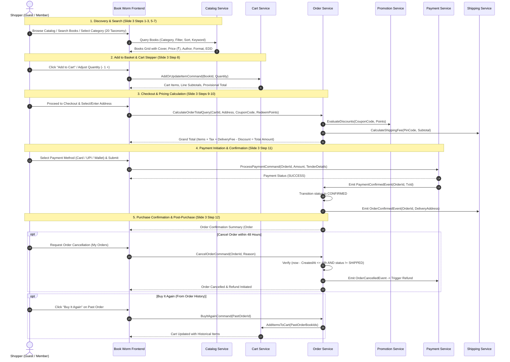
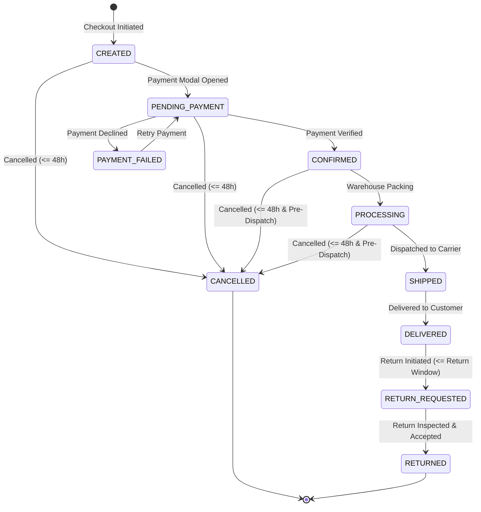
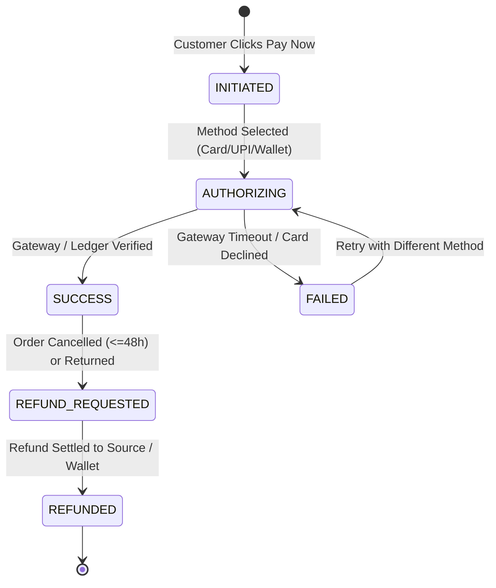
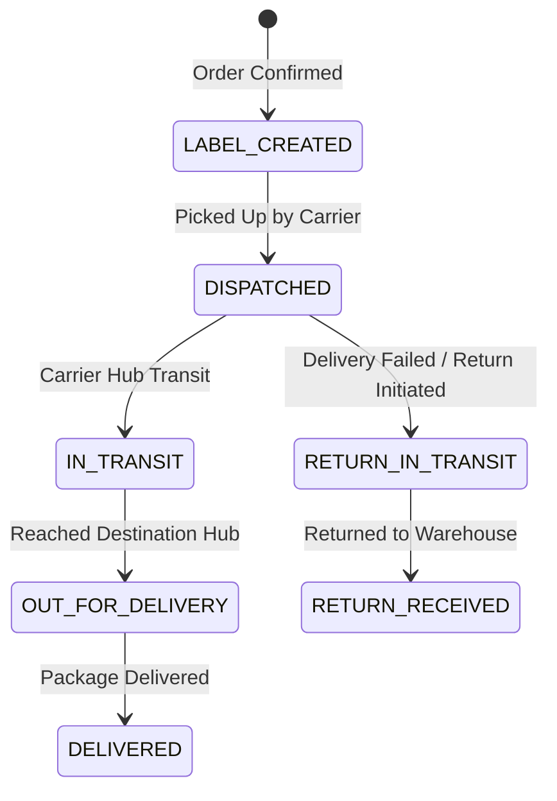

# Book Worm Platform — Domain Model Specification (v1.1)

This document establishes the formal Domain-Driven Design (DDD) model for the **Book Worm** E-Commerce platform, derived directly from the approved requirements specification and architecture blueprint.

---

## 1. Domain Structure & Strategic Classification

```
┌────────────────────────────────────────────────────────────────────────────────────────┐
│                                BOOK WORM DOMAIN LANDSCAPE                              │
├────────────────────────────┬─────────────────────────────┬─────────────────────────────┤
│        CORE DOMAINS        │     SUPPORTING DOMAINS      │       GENERIC DOMAINS       │
├────────────────────────────┼─────────────────────────────┼─────────────────────────────┤
│ • Catalog & Discovery      │ • Store Governance          │ • Member & Identity         │
│ • Cart & Checkout          │ • Recommendation Engine     │ • Payment Processing        │
│ • Order Lifecycle          │ • Promotion & Loyalty       │ • Shipping & Fulfillment    │
└────────────────────────────┴─────────────────────────────┴─────────────────────────────┘
```

### 1.1 Strategic Domain Categorization
1. **Core Domains (Competitive Differentiator)**:
   - **Catalog & Discovery**: 20-category taxonomy, faceted search, book formats, multi-language filtering, author profiles, and customer reviews (100-character limit).
   - **Cart & Checkout**: Persistent/session carts, quantity steppers, and pricing calculation engine.
   - **Order Lifecycle**: Order state machine, "Buy It Again" reordering, and the configurable 48-hour cancellation policy.
2. **Supporting Domains (Business Capability Enablers)**:
   - **Store Governance**: Multi-store administration and configurable store policy parameters (tax rate, free-delivery threshold, cancellation window, return window, loyalty points rate).
   - **Recommendation Engine**: Curated shelves (*Recommended for You*, *Bestsellers this Month*, *New Launches*, *Related Reads*).
   - **Promotion & Loyalty**: Promo coupon evaluation and gift points redemption.
3. **Generic Domains (Standardized Infrastructure Capabilities)**:
   - **Member & Identity**: User authentication, JWT issuance, profile, saved addresses, and wishlist.
   - **Payment Processing**: Gateway tokenization, simulated/actual payment handoff, wallet/gift balance ledger, and automated refund triggers.
   - **Shipping & Fulfillment**: Tentative Delivery Date (EDD) estimation, shipping rate evaluation, carrier tracking, and reverse logistics.

---

## 2. Bounded Context Map & Context Relationships

```mermaid
flowchart TB
    subgraph MemberContext ["Member & Identity Context [Generic]"]
        UserAgg["User / Member AR"]
        WishlistAgg["Wishlist AR"]
    end

    subgraph StoreContext ["Store Governance Context [Supporting]"]
        StoreAgg["Store AR"]
        StorePolicyAgg["StorePolicy AR"]
    end

    subgraph CatalogContext ["Catalog & Discovery Context [Core]"]
        BookAgg["Book AR"]
        AuthorAgg["Author AR"]
        CategoryAgg["Category AR"]
        ReviewAgg["Review AR"]
    end

    subgraph RecommendationContext ["Recommendation Context [Supporting]"]
        RecommendationModel["Recommendation Engine"]
    end

    subgraph CartContext ["Cart Context [Core]"]
        CartAgg["Cart AR"]
    end

    subgraph OrderContext ["Order Context [Core]"]
        OrderAgg["Order AR"]
    end

    subgraph PromotionContext ["Promotion & Loyalty Context [Supporting]"]
        CouponAgg["Coupon AR"]
        LoyaltyAgg["LoyaltyAccount AR"]
    end

    subgraph PaymentContext ["Payment Context [Generic]"]
        PaymentTxAgg["PaymentTransaction AR"]
        WalletAgg["WalletAccount AR"]
    end

    subgraph ShippingContext ["Shipping & Logistics Context [Generic]"]
        ShipmentAgg["Shipment AR"]
        EDDCalculator["EDD Calculation Engine"]
    end

    %% Context Interactions & DDD Relationship Types
    MemberContext -->|Customer Identity & Saved Address [Customer/Supplier]| OrderContext
    MemberContext -->|Wishlist Target [Conformist]| CatalogContext
    StoreContext -->|Policy Rules & Thresholds [Shared Kernel / Upstream]| OrderContext
    StoreContext -->|Policy Rules [Upstream]| ShippingContext
    
    CatalogContext -->|Product Snapshot & Price [Customer/Supplier]| CartContext
    CatalogContext -->|Immutable Book Metadata [Shared Kernel]| OrderContext
    CatalogContext -->|Catalog Feeds| RecommendationContext
    
    CartContext -->|Cart Checked Out Event| OrderContext
    OrderContext -->|Order History Feed| RecommendationContext
    
    OrderContext -->|Apply Discount / Points [Customer/Supplier]| PromotionContext
    OrderContext -->|Payable Amount & Token [Open Host / ACL]| PaymentContext
    OrderContext -->|Order Confirmed Event [Pub/Sub]| ShippingContext
    
    PaymentContext -->|Payment Settled / Failed Event| OrderContext
    ShippingContext -->|EDD Display Contract| CatalogContext
    ShippingContext -->|Shipment Status Updates| OrderContext
```

### Context Interaction Patterns
- **StoreContext $\rightarrow$ OrderContext & ShippingContext (Upstream-Downstream / Supplier-Customer)**: Store policies (tax percentage, delivery thresholds, cancellation window) feed downstream pricing and state-machine rules.
- **CatalogContext $\rightarrow$ CartContext & OrderContext (Conformist / Immutable Snapshot)**: When a book is added to cart or ordered, the SKU, title, author, format, and unit price are captured as immutable value objects to protect order integrity against subsequent catalog edits.
- **OrderContext $\rightarrow$ PaymentContext (Anti-Corruption Layer / Open Host Service)**: Order passes calculated payable amounts and receives standardized payment confirmation/failure events without exposing internal order state machines.
- **OrderContext $\rightarrow$ ShippingContext (Domain Event / Pub-Sub)**: `OrderConfirmedEvent` triggers initial shipment creation and tracking allocation.

---

## 3. Detailed Domain Model (Aggregates, Entities & Value Objects)

### 3.1 Member & Identity Context

| Aggregate / Entity | Type | Identity / Keys | Attributes & Value Objects | Invariants & Business Rules |
| :--- | :--- | :--- | :--- | :--- |
| **`User`** | Aggregate Root | `UserId` (UUID) | `Email` (VO), `HashedPassword` (VO), `FullName` (VO), `PhoneNumber` (VO: +91 format), `UserRole` (ENUM: `GUEST`, `MEMBER`, `STORE_ADMIN`, `CATALOG_ADMIN`, `CSR`, `FULFILLMENT`), `CreatedAt` | • Email must be unique and valid.<br>• Passwords must be hashed using BCrypt/Argon2.<br>• Unauthenticated guest users are assigned temporary session IDs. |
| **`Address`** | Entity (inside User) | `AddressId` (UUID) | `UserId` (FK), `RecipientName` (VO), `AddressLine` (String), `City` (String), `State` (String), `Country` (String, default "India"), `PinCode` (VO: 6 digits), `Phone` (VO), `IsDefault` (Boolean) | • At most one address can have `IsDefault = true` per user.<br>• PIN code must match valid postal format. |
| **`Wishlist`** | Aggregate Root | `WishlistId` (UUID) | `UserId` (FK), `Items: Set<WishlistItem>` (`BookId`, `AddedAt`) | • Duplicate book additions for the same user are rejected (idempotent). |

---

### 3.2 Store Governance Context

| Aggregate / Entity | Type | Identity / Keys | Attributes & Value Objects | Invariants & Business Rules |
| :--- | :--- | :--- | :--- | :--- |
| **`Store`** | Aggregate Root | `StoreId` (UUID) | `StoreCode` (String), `StoreName` (String), `Currency` (CurrencyCode, default "INR"), `Locale` (String, default "en_IN"), `IsActive` (Boolean) | • Base currency defaults to INR (`₹`). |
| **`StorePolicy`** | Entity / Child | `PolicyId` (UUID) | `StoreId` (FK), `CancellationWindowHours` (Int, default 48), `TaxRatePercent` (BigDecimal, provisional ~12.00%), `FreeDeliveryThreshold` (Money, provisional ₹500.00), `StandardDeliveryFee` (Money, provisional ₹50.00), `LoyaltyRedemptionRate` (BigDecimal, provisional 1 pt = ₹1.00), `ReturnWindowDays` (Int, provisional 7 days) | • **All policy parameters are configurable and provisional**.<br>• Must not contain negative numeric values. |

---

### 3.3 Catalog & Discovery Context

| Aggregate / Entity | Type | Identity / Keys | Attributes & Value Objects | Invariants & Business Rules |
| :--- | :--- | :--- | :--- | :--- |
| **`Category`** | Aggregate Root | `CategoryId` (Long) | `Name` (String), `Slug` (String), `DisplayOrder` (Int), `IsActive` (Boolean) | • Fixed taxonomy of **20 categories** as defined in UI wireframe (Romance, Mystery, Sci-Fi, Fantasy, Historical, Biography, Self-help, Memoir, Travel, Cooking, Children's, Young Adult, Comics & Graphic Novels, Poetry, Drama, Science, Philosophy, Religion, Language Learning, All). |
| **`Author`** | Aggregate Root | `AuthorId` (UUID) | `Name` (String), `Bio` (String), `AvatarUrl` (String) | • Displays author metadata on Product Details Page ("About the writer"). |
| **`Publisher`** | Entity / Master | `PublisherId` (UUID) | `Name` (String) | • Displayed as "Published by: [Publisher Name]". |
| **`Book`** | Aggregate Root | `BookId` (UUID) | `Title` (String), `ISBN` (VO), `AuthorId` (FK), `PublisherId` (FK), `CategoryId` (FK), `Format` (ENUM: `PAPERBACK`, `HARDCOVER`, `EBOOK`), `Price` (Money VO: INR), `Language` (String), `CoverImageUrl` (String), `Description` (String), `SalesCount` (Long), `AverageRating` (BigDecimal), `RatingCount` (Int), `StockQuantity` (Int), `TentativeDeliveryDate` (LocalDate VO) | • `Price` must be $\ge 0$.<br>• `StockQuantity` must be $\ge 0$.<br>• Format must be one of Paperback, Hardcover, or eBook. |
| **`Review`** | Aggregate Root | `ReviewId` (UUID) | `BookId` (FK), `UserId` (FK), `ReviewerName` (String), `Rating` (Int: 1 to 5), `ReviewText` (String, max 100 chars), `CreatedAt` (Instant) | • **Strict Invariant**: `ReviewText` character length must be $\le 100$ characters.<br>• `Rating` must be between 1 and 5.<br>• Only authenticated users can submit reviews. |

---

### 3.4 Cart Context

| Aggregate / Entity | Type | Identity / Keys | Attributes & Value Objects | Invariants & Business Rules |
| :--- | :--- | :--- | :--- | :--- |
| **`Cart`** | Aggregate Root | `CartId` (UUID) | `UserId` (UUID, nullable), `SessionToken` (String, nullable for Member), `Items: List<CartItem>`, `UpdatedAt` (Instant) | • Either `UserId` or `SessionToken` must be non-null.<br>• Merging guest cart into member cart combines quantities without duplicating line items. |
| **`CartItem`** | Entity | `CartItemId` (UUID) | `CartId` (FK), `BookId` (FK), `Quantity` (Int), `UnitPrice` (Money VO), `TentativeDeliveryDate` (LocalDate VO) | • `Quantity` must be $\ge 1$.<br>• Quantity modification supported via `- 1 +` stepper operations. |

---

### 3.5 Order Context

| Aggregate / Entity | Type | Identity / Keys | Attributes & Value Objects | Invariants & Business Rules |
| :--- | :--- | :--- | :--- | :--- |
| **`Order`** | Aggregate Root | `OrderId` (UUID) | `OrderNumber` (String UK: e.g. "ORD-2025-XXXX"), `UserId` (UUID), `Status` (OrderStatus ENUM), `Items: List<OrderItem>`, `PricingSummary` (VO: Subtotal, TaxAmount, DeliveryCharge, DiscountAmount, TotalPayable), `DeliveryAddress` (AddressSnapshot VO), `TentativeDeliveryDate` (LocalDate), `CreatedAt` (Instant), `CancelledAt` (Instant, nullable) | • Order must contain at least 1 `OrderItem`.<br>• **48-Hour Cancellation Rule**: Customer can cancel if `now - CreatedAt <= CancellationWindowHours` (default 48h) AND `Status IN (CREATED, PENDING_PAYMENT, CONFIRMED, PROCESSING)`.<br>• Order amounts are immutable once confirmed. |
| **`OrderItem`** | Value Object / Entity | `OrderItemId` (UUID) | `BookId` (UUID), `BookTitle` (String), `Format` (String), `Quantity` (Int), `UnitPrice` (Money VO), `TotalPrice` (Money VO) | • Snapshot of book data at checkout time.<br>• `TotalPrice = UnitPrice * Quantity`. |
| **`OrderStatusHistory`**| Entity | `HistoryId` (UUID) | `OrderId` (FK), `FromStatus` (OrderStatus), `ToStatus` (OrderStatus), `Reason` (String), `ChangedAt` (Instant) | • Append-only audit record of every order status transition. |

---

### 3.6 Promotion & Loyalty Context

| Aggregate / Entity | Type | Identity / Keys | Attributes & Value Objects | Invariants & Business Rules |
| :--- | :--- | :--- | :--- | :--- |
| **`Coupon`** | Aggregate Root | `CouponId` (UUID) | `Code` (String UK), `DiscountType` (ENUM: `PERCENTAGE`, `FIXED_AMOUNT`), `DiscountValue` (BigDecimal), `MinOrderAmount` (Money), `MaxDiscountAmount` (Money, nullable), `ValidUntil` (Instant), `IsActive` (Boolean) | • Discount cannot exceed order subtotal.<br>• Coupon code evaluation checks active status and minimum spend threshold. |
| **`LoyaltyAccount`** | Aggregate Root | `AccountId` (UUID) | `UserId` (UUID UK), `PointsBalance` (Int), `UpdatedAt` (Instant) | • Points balance cannot be negative.<br>• Redemption converts points using `LoyaltyRedemptionRate` (Provisional: 1 pt = ₹1). |

---

### 3.7 Payment Context

| Aggregate / Entity | Type | Identity / Keys | Attributes & Value Objects | Invariants & Business Rules |
| :--- | :--- | :--- | :--- | :--- |
| **`PaymentTransaction`**| Aggregate Root | `TransactionId` (UUID) | `OrderId` (UUID), `PaymentMethod` (ENUM: `CREDIT_CARD`, `DEBIT_CARD`, `UPI`, `WALLET`), `Amount` (Money VO), `Status` (PaymentStatus ENUM), `GatewayRefId` (String), `MaskedCardNumber` (String, e.g. "XXXX-XXXX-XXXX-1234"), `CreatedAt` (Instant) | • **PCI-DSS Rule**: Raw card numbers, CVVs, and expiry dates are never persisted in the database.<br>• Transaction amount must strictly match Order total payable. |
| **`WalletAccount`** | Aggregate Root | `WalletId` (UUID) | `UserId` (UUID UK), `Balance` (Money VO), `Transactions: List<WalletTx>` | • Balance must be $\ge 0$.<br>• Debits require prior authorization and link directly to an `OrderId`. |
| **`RefundTransaction`**| Aggregate Root | `RefundId` (UUID) | `PaymentTransactionId` (FK), `OrderId` (FK), `RefundAmount` (Money VO), `Status` (ENUM: `INITIATED`, `PROCESSED`, `FAILED`), `Reason` (String), `ProcessedAt` (Instant) | • Full refund triggered automatically upon valid 48-hour order cancellation or return receipt. |

---

### 3.8 Shipping & Fulfillment Context

| Aggregate / Entity | Type | Identity / Keys | Attributes & Value Objects | Invariants & Business Rules |
| :--- | :--- | :--- | :--- | :--- |
| **`Shipment`** | Aggregate Root | `ShipmentId` (UUID) | `OrderId` (UUID UK), `CarrierName` (String), `TrackingNumber` (String), `Status` (ShipmentStatus ENUM), `EstimatedDeliveryDate` (LocalDate), `DispatchedAt` (Instant), `DeliveredAt` (Instant) | • Shipment is created upon order `CONFIRMED` event.<br>• EDD calculated based on destination PIN code and fulfillment center SLA. |
| **`TrackingEvent`** | Entity | `EventId` (UUID) | `ShipmentId` (FK), `EventStatus` (String), `Location` (String), `EventTimestamp` (Instant), `Description` (String) | • Append-only timeline of carrier milestone scans. |

---

## 4. End-to-End Customer Journey Domain Workflows



### Alternative Paths & Failure Handling
1. **Payment Rejection / Timeout**:
   - Order remains in `PENDING_PAYMENT` state with payment retry option.
   - If payment is not completed within session TTL, provisional stock locks are released.
2. **Cancellation Rejection (> 48 Hours or Already Shipped)**:
   - Command fails with domain validation error: `"Cancellation window expired or order already dispatched. Please initiate return upon delivery."`
3. **Out of Stock during "Buy It Again"**:
   - Available items from historical order are added to cart; unavailable items are flagged with notifications.

---

## 5. Domain Commands, Queries & Events (CQRS View)

```
┌────────────────────────────────────────────────────────────────────────────────────────┐
│                              COMMANDS, QUERIES & EVENTS                                │
├───────────────────────────────┬───────────────────────────────┬────────────────────────┤
│ COMMANDS (State Mutators)     │ QUERIES (Read Operations)     │ DOMAIN EVENTS (Pub/Sub)│
├───────────────────────────────┼───────────────────────────────┼────────────────────────┤
│ • RegisterUserCommand         │ • GetCategoriesQuery          │ • UserRegisteredEvent  │
│ • LoginCommand / MergeCart    │ • SearchBooksQuery            │ • CartItemAddedEvent   │
│ • AddCartItemCommand          │ • GetBookDetailsQuery         │ • CartMergedEvent      │
│ • UpdateCartQuantityCommand   │ • GetReviewsByBookQuery       │ • OrderCreatedEvent    │
│ • SubmitReviewCommand         │ • GetCartSummaryQuery         │ • OrderConfirmedEvent  │
│ • ToggleWishlistCommand       │ • CalculateOrderTotalQuery    │ • OrderCancelledEvent  │
│ • ApplyCouponCommand          │ • GetOrderDetailsQuery        │ • PaymentSuccessEvent  │
│ • CreateOrderCommand          │ • GetOrderHistoryQuery        │ • PaymentFailedEvent   │
│ • ProcessPaymentCommand       │ • GetRecommendationsQuery     │ • ShipmentCreatedEvent │
│ • CancelOrderCommand (48h)    │ • TrackShipmentQuery          │ • RefundInitiatedEvent │
│ • BuyItAgainCommand           │                               │                        │
└───────────────────────────────┴───────────────────────────────┴────────────────────────┘
```

---

## 6. Domain State Transition Lifecycles

### 6.1 Order State Lifecycle



### 6.2 Payment State Lifecycle



### 6.3 Shipment State Lifecycle



---

## 7. Domain-to-Requirement Traceability Matrix

| Requirement / Wireframe Source | Domain Concept / Aggregate | DDD Implementation Mechanism | Traceability Status |
| :--- | :--- | :--- | :--- |
| **Slide 3: Journey Steps 1, 2** | `User`, `Order` | `LoginCommand`, `GetOrderHistoryQuery`, `BuyItAgainCommand` | Verified |
| **Slide 3: Journey Steps 3, 5, 6** | `Category`, `Book`, `Publisher` | 20-Category taxonomy, `SearchBooksQuery`, Brand filters | Verified |
| **Slide 3: Journey Steps 7, 8** | `Book`, `Cart`, `Shipment` | Tentative Delivery Date (EDD), `CartItem` quantity steppers | Verified |
| **Slide 3: Journey Steps 9, 10** | `Order`, `Address`, `Promotion` | `CalculateOrderTotalQuery`, `Coupon`, `LoyaltyAccount` | Verified |
| **Slide 3: Journey Step 11** | `PaymentTransaction` | Multi-tender `ProcessPaymentCommand` (Card, UPI, Wallet) | Verified |
| **Slide 3: Journey Step 12** | `Order` (48h Cancellation) | `CancelOrderCommand` enforcing configurable 48h window | Verified |
| **Slide 5 / Home Wireframe** | `Category`, `Recommendation` | 20 Categories sidebar, *Recommended*, *Bestsellers*, *New Launches* | Verified |
| **Slide 7 / Product Details Page** | `Book`, `Author`, `Review` | Book metadata, "About the writer", Reviews ($\le 100$ char limit) | Verified |
| **Slide 8 / Checkout Wireframe** | `Cart`, `Order`, `Address` | Quantity stepper, Saved address toggle, Grand Total breakdown | Verified |
| **Slide 9 / Payment Wireframe** | `PaymentTransaction` | Credit/Debit Card, UPI, Wallet modal | Verified |
| **Slide 10 / Confirmation Screen** | `Order`, `Shipment` | Order confirmation modal with items summary & EDD | Verified |

---

## 8. Assumptions, Open Questions & Design Risks

### 8.1 Provisional & Configurable Parameter Catalog

| Parameter | Default Provisional Value | Configuration Location | Status / Rationale |
| :--- | :--- | :--- | :--- |
| **Tax Rate** | `12.00%` | `StorePolicy.taxRatePercent` | **Provisional**: Subject to regional GST/tax rates. |
| **Free Delivery Threshold** | `₹500.00` | `StorePolicy.freeDeliveryThreshold` | **Provisional**: Orders $\ge ₹500$ qualify for free delivery. |
| **Standard Delivery Charge**| `₹50.00` | `StorePolicy.standardDeliveryFee` | **Provisional**: Applied when order subtotal is below threshold. |
| **Order Cancellation Window**| `48 Hours` | `StorePolicy.cancellationWindowHours`| **Configurable**: Specified on Slide 3 Journey Step 12. |
| **Return Window** | `7 Days` | `StorePolicy.returnWindowDays` | **Provisional**: Standard e-commerce return window post-delivery. |
| **Loyalty Points Conversion**| `1 Point = ₹1.00` | `StorePolicy.loyaltyRedemptionRate` | **Provisional**: Point redemption valuation. |

### 8.2 Scope Boundary Notes & Intentional Exclusions
1. **Customer Journey Step 4**: Slide 3 lists Step 1, 2, 3 and skips directly to Step 5. Step 4 is absent in source requirements; no undocumented assumptions have been invented.
2. **"My Writers" Navigation Item**: Modeled as an author follow / author profile lookup capability (`Author` entity and `GET /authors/{id}`); no unrequested social feeds have been added.
3. **Inventory Management**: Soft inventory decrement/check is modeled at checkout; deep warehouse inventory supply-chain orchestration is intentionally out of scope.

---

## 9. Recommended Backend Spring Boot Module Mapping

```
com.bookworm/
├── member/
│   ├── domain/       # User, Address, Wishlist, UserRole, Email VO
│   ├── application/  # UserAuthService, MemberProfileService, WishlistService
│   └── web/          # AuthController, MemberController
├── store/
│   ├── domain/       # Store, StorePolicy (Provisional parameters)
│   ├── application/  # StoreGovernanceService
│   └── web/          # StoreAdminController
├── catalog/
│   ├── domain/       # Book, Category (20 Taxonomy), Author, Publisher, Review
│   ├── application/  # CatalogQueryService, ReviewSubmissionService
│   └── web/          # CatalogController, BookController, ReviewController
├── recommendation/
│   ├── domain/       # RecommendationStrategy, MerchandisingRules
│   ├── application/  # RecommendationService (Bestsellers, For-You, Related)
│   └── web/          # RecommendationController
├── cart/
│   ├── domain/       # Cart, CartItem, CartMergePolicy
│   ├── application/  # CartManagementService
│   └── web/          # CartController
├── order/
│   ├── domain/       # Order, OrderItem, OrderStatus, OrderPricingSummary
│   ├── application/  # OrderOrchestrationService, OrderCancellationService
│   └── web/          # OrderController
├── promotion/
│   ├── domain/       # Coupon, LoyaltyAccount, DiscountPolicy
│   ├── application/  # PromotionEvaluationService
│   └── web/          # PromotionController
├── payment/
│   ├── domain/       # PaymentTransaction, WalletAccount, RefundTransaction
│   ├── application/  # PaymentProcessingService, WalletLedgerService
│   └── web/          # PaymentController
└── shipping/
    ├── domain/       # Shipment, TrackingEvent, EDDCalculator
    ├── application/  # ShippingLogisticsService
    └── web/          # ShippingController
```
