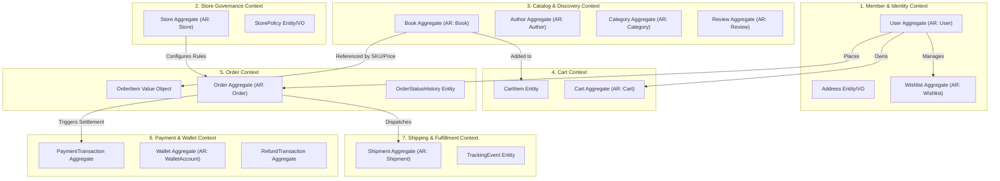
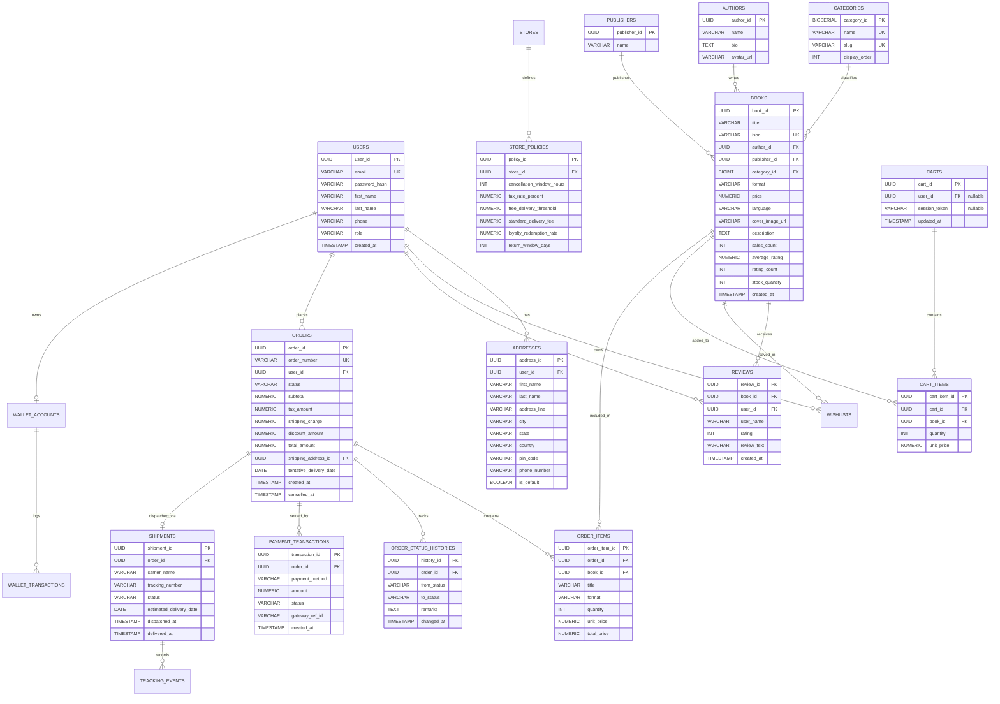
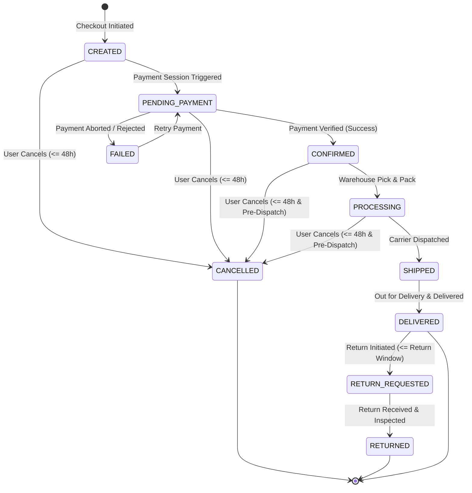
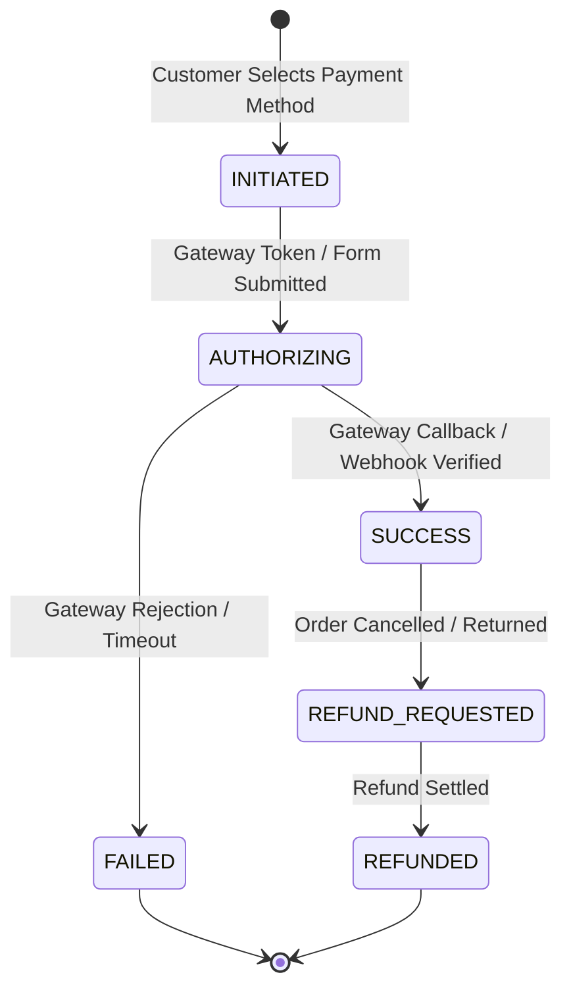

# Book Worm Platform — Domain Model Specification

## 1. Overview & DDD Strategic Design

This document specifies the Domain Model for the **Book Worm** E-Commerce platform using Domain-Driven Design (DDD) principles. It bridges the architectural wireframes and functional requirements into domain aggregates, entities, value objects, domain events, and state machines ahead of implementation.

---

## 2. Bounded Contexts & Aggregate Boundaries

---

## 3. Aggregate Definitions & Invariants

### 3.1 `MemberContext`
#### Aggregate Root: `User`
- **Entities / VOs**: `Address`, `Role` (ENUM), `UserCredentials`
- **Invariants**:
  - `email` must be unique and valid.
  - Passwords must be hashed; raw text is never persisted.
  - A user can have multiple addresses, but at most one `is_default = true`.
  - Roles: `ROLE_GUEST`, `ROLE_MEMBER`, `ROLE_STORE_ADMIN`, `ROLE_CATALOG_ADMIN`, `ROLE_CSR`, `ROLE_FULFILLMENT`.

#### Aggregate Root: `Wishlist`
- **Entities / VOs**: `WishlistItem` (`user_id`, `book_id`, `added_at`)
- **Invariants**:
  - A user cannot add duplicate book entries to their wishlist (unique composite constraint on `(user_id, book_id)`).

---

### 3.2 `StoreContext`
#### Aggregate Root: `Store`
- **Entities / VOs**: `StorePolicy`
- **Invariants**:
  - Store must specify base currency (default: `INR`).
  - Store policies encapsulate provisional/configurable parameters:
    - `cancellation_window_hours`: Default 48 hours (Configurable).
    - `tax_rate_percent`: Provisional default ~12.00% (Configurable).
    - `free_delivery_threshold`: Provisional default ₹500.00 (Configurable).
    - `standard_delivery_fee`: Provisional default ₹50.00 (Configurable).
    - `loyalty_redemption_rate`: Provisional default 1 point = ₹1.00 (Configurable).
    - `return_window_days`: Provisional default 7 days (Configurable).

---

### 3.3 `CatalogContext`
#### Aggregate Root: `Book`
- **Entities / VOs**: `Author`, `Publisher`, `Category`, `BookFormat` (ENUM: `PAPERBACK`, `HARDCOVER`, `EBOOK`), `Money` (Price, Currency)
- **Invariants**:
  - `price` must be $\ge 0$.
  - `stock_quantity` must be $\ge 0$.
  - Category must belong to one of the 20 taxonomy categories.
  - `average_rating` is computed from approved reviews ($1.0 \le \text{avg} \le 5.0$).

#### Aggregate Root: `Review`
- **Entities / VOs**: `Rating` (1 to 5), `ReviewText`
- **Invariants**:
  - `rating` must be an integer between 1 and 5.
  - `review_text` must not exceed **100 characters** (`@Size(max=100)`).
  - Unauthenticated users cannot submit reviews.

---

### 3.4 `CartContext`
#### Aggregate Root: `Cart`
- **Entities / VOs**: `CartItem` (`book_id`, `quantity`, `unit_price`, `tentative_delivery_date`)
- **Invariants**:
  - `quantity` for any line item must be $\ge 1$.
  - Guest carts are tracked via `session_token`.
  - When a guest logs in, their cart is merged into their member account cart.
  - If a duplicate book is added during cart merge, quantities are summed up (capped at available inventory).

---

### 3.5 `OrderContext`
#### Aggregate Root: `Order`
- **Entities / VOs**: `OrderItem`, `OrderStatusHistory`, `OrderPricing` (Subtotal, Tax, Shipping, Discount, Total), `DeliveryAddress` (immutable snapshot)
- **Invariants**:
  - An order must contain at least one `OrderItem`.
  - Prices in `OrderItem` are immutable snapshots at the moment of checkout.
  - `total_amount = subtotal + tax_amount + shipping_charge - discount_amount`.
  - **Cancellation Rule**: Order can be cancelled if `elapsed_time <= cancellation_window_hours` AND `status IN ('CREATED', 'PENDING_PAYMENT', 'CONFIRMED', 'PROCESSING')`.
  - Transition to `CONFIRMED` requires verified successful payment.

---

### 3.6 `PaymentContext`
#### Aggregate Root: `PaymentTransaction`
- **Entities / VOs**: `PaymentMethod` (ENUM: `CREDIT_CARD`, `DEBIT_CARD`, `UPI`, `WALLET`), `TransactionStatus` (ENUM: `PENDING`, `SUCCESS`, `FAILED`, `REFUNDED`), `GatewayReference`
- **Invariants**:
  - Card details are tokenized; raw card number and CVV are never stored.
  - `amount` must equal the payable amount of the associated order.
  - Every transaction has an immutable audit log.

#### Aggregate Root: `WalletAccount`
- **Entities / VOs**: `WalletTransaction` (Credit/Debit entries)
- **Invariants**:
  - Wallet balance cannot drop below zero.
  - Points/Wallet deductions are logged with debit transactions linking to the respective `order_id`.

---

### 3.7 `ShippingContext`
#### Aggregate Root: `Shipment`
- **Entities / VOs**: `TrackingEvent` (`status`, `location`, `timestamp`), `EstimatedDeliveryDate`
- **Invariants**:
  - An order shipment is created upon order confirmation.
  - `tentative_delivery_date` is computed using destination PIN code and warehouse dispatch SLA.

---

## 4. Entity-Relationship (ER) Schema Design

---

## 5. Domain State Machines & Lifecycles

### 5.1 Order Lifecycle State Machine

### 5.2 Payment Lifecycle State Machine

---

## 6. Provisional vs. Confirmed Business Parameters

| Parameter | Type / Target | Default Provisional Value | Scope & Configuration Strategy |
| :--- | :--- | :--- | :--- |
| **Tax Rate** | `NUMERIC(5,2)` | `12.00%` | Configured in `STORE_POLICIES.tax_rate_percent` / `application.properties`. Pending final tax law confirmation. |
| **Free Delivery Threshold** | `NUMERIC(10,2)` | `₹500.00` | Configured in `STORE_POLICIES.free_delivery_threshold`. Orders $\ge ₹500$ get `delivery_charges = 0`. |
| **Standard Delivery Charge** | `NUMERIC(10,2)` | `₹50.00` | Configured in `STORE_POLICIES.standard_delivery_fee`. Applied when total $< free\_delivery\_threshold$. |
| **Cancellation Window** | `INT` (Hours) | `48` | Configured in `STORE_POLICIES.cancellation_window_hours`. Customer journey Slide 3 specifies 48 hrs. |
| **Return Window** | `INT` (Days) | `7` | Configured in `STORE_POLICIES.return_window_days`. Allowed post-delivery. Pending confirmation. |
| **Loyalty Points Rate** | `NUMERIC(5,2)` | `1.00` | Configured in `STORE_POLICIES.loyalty_redemption_rate` (1 point = ₹1). Pending confirmation. |
| **Review Max Length** | `INT` (Chars) | `100` | Confirmed by Slide 5 UI wireframe (`0/100` counter). Hard constraint `@Size(max = 100)`. |
| **20-Category Taxonomy** | `List<String>` | Fixed 20 Categories | Confirmed by Slide 5/6 UI wireframe sidebar. Seeded in DB master data. |

---

## 7. Additional Features Requiring Confirmation

The following features were identified during wireframe and flow analysis as helpful additions; they are cleanly separated and marked pending stakeholder confirmation:

1. **Social Login / OAuth2 (Google/GitHub)**: UI shows standard login; OAuth2 can be added as an extension.
2. **Dynamic Tier-Based Loyalty Points (Silver/Gold/Platinum)**: Basic 1:1 points redemption is modeled; tiered accrual requires confirmation.
3. **Multi-Currency Dynamic Conversion**: Backend defaults to INR (`₹`); multi-currency rates (USD, EUR) require conversion service confirmation.
4. **SMS / WhatsApp Gateway Notifications**: Order confirmation is currently modeled via REST receipt and DB record; external SMS integration pending confirmation.
